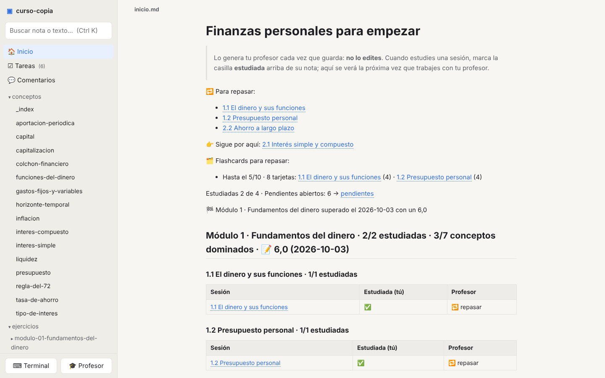
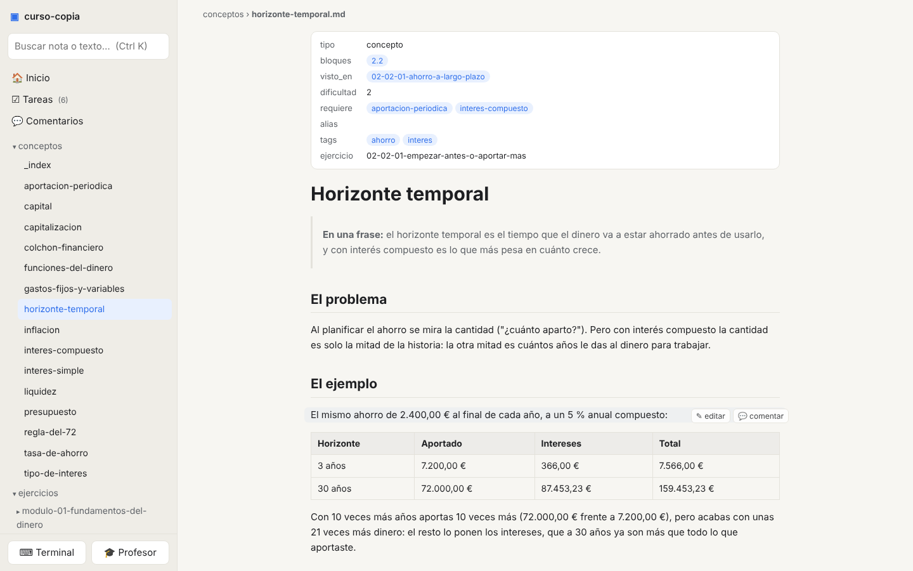
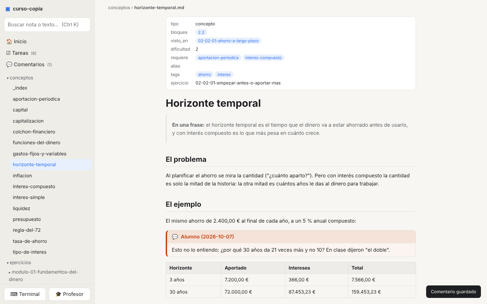
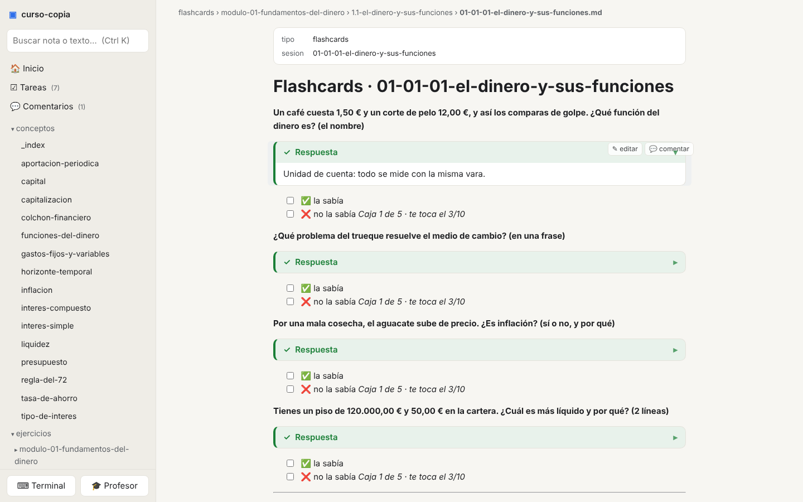
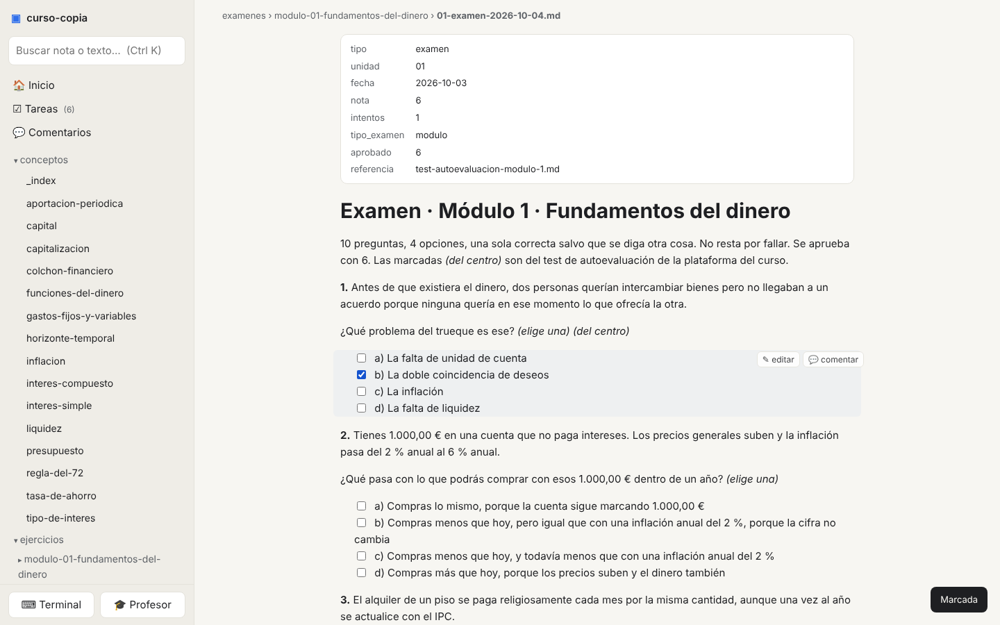
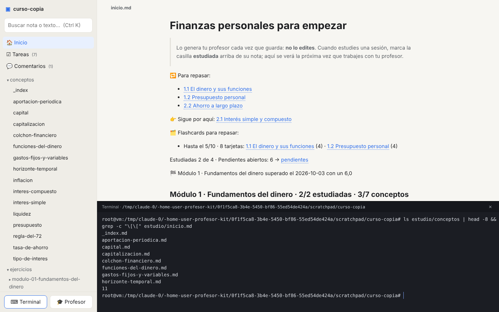
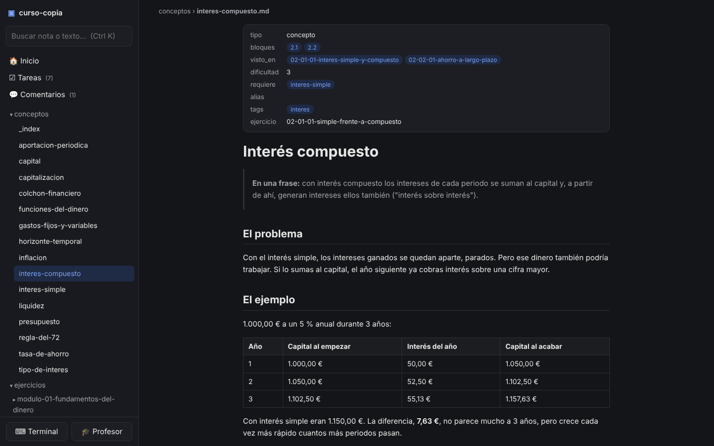

# cuaderno-app · plan vivo

**Nació como punto 0 el 2026-10-07** · **Repo:** `rsotor/cuaderno-app` (privado al nacer, público después) · **Licencia:** MIT

## 0. Estado

**Última actualización:** 2026-10-13 (**bloque «navegación» hecho y en `main`: búsqueda en modal (#32) y reorganización A2 (#35), instalada `9fac013`; repo público temporal con `main` protegida (`tests-ok`) y CI de PR en Linux y Windows (macOS con etiqueta, #29); recarga en vivo que reconecta (#27); siguiente: la prueba de Roberto en su Mac (botones del ratón y gesto de dos dedos, uso sin Ajustes en el lateral), la firma estable para que macOS no pida el permiso de Documentos en cada instalación, y vaciar el Inbox**); antes, 2026-10-10 (**noche: prueba local en el Mac hecha (§5 bis del plan de Electron), PR #24 de Electron y PR #25 de `npm run instalar` mergeados; siguiente: el Windows del padre (qué versión tiene, el `.exe` de la CI y §5-6 de `docs/planes/electron-prueba-local.md`) y, mientras, el feedback de uso ya en la app (Inbox: ⌘O/⌘F, ventana maximizada, última nota)**; antes ese día, **bloque «app de escritorio con Electron» hecho, T1 a T8, mergeado en `main` (PR #24)**: plan redactado, revisado dos veces y aprobado por Roberto; spike con las cuatro preguntas SÍ en Linux (`docs/planes/electron.md` §5); T1-T7 ese mismo día (servidor en un `utilityProcess`, lo del navegador que en la app cambia, el Node del kit, abrir carpeta, menú en castellano con los atajos de Roberto, icono y empaquetado sin firma, CI) y T8, el cierre: este documento, el README, las capturas para la crítica de diseño y el texto del PR (`docs/planes/pr-electron.md`); **ronda de crítica de diseño sobre esas capturas hecha** (`docs/diseno/critica-2026-10-10-electron.md`: 10 objeciones, las 10 aplicadas: «Arrancando…» con la mesa y el logo, icono con margen, menú Archivo, Cuadernos con los recientes primero, la ventana que abre donde se cerró, título con lo abierto, Diagnóstico por utilidad, atajos ⌘N / ⌘[ / ⌘] / Ctrl \\ / Ctrl `, Ayuda por utilidad, pistas con ⌘ en Mac); cifras y lo que queda, en «Ahora»; decisión: el bloque «edición en sitio», detrás de Electron; ver «Después») y 2026-10-09 (tarde; la otra sesión del día cerró con «siguiente: acciones rápidas», que pasa detrás de Electron), bloque «edición y comentarios» hecho en su rama más la tanda de feedback de uso; antes ese día, revisión de diseño (tandas 1 y 2: lectura a 16 px, hoja, índice de la nota, copy, teclado, errores) tras una sola dirección (`localhost:7331`) y el feedback de uso por tareas `#feedback`.

**Ahora**
- **Bloque «navegación», hecho y en `main` (2026-10-13; plan `docs/planes/navegacion.md`, decisiones de Roberto en `docs/diseno/navegacion-2026-10-13-roberto.md`):** auditoría de estructura (`revision-2026-10-13.md`), recorrido cognitivo por tareas (`recorrido-2026-10-13.md`), referentes (`referentes-2026-10-13.md`) y maquetas A/A2 (`docs/diseno/maquetas-2026-10-13/`); PR 1 búsqueda en modal (⌘F, ⌘O y ⌘K, «Apuntar tarea»; #32) y PR 2 A2 (selector de cuaderno, línea de estado con Guardar y «sin cambios», fila de accesos, ‹ › con ratón y gesto, menú «…» de la nota, Ajustes y Terminal abajo; #35), cada uno con su crítica de diseño. Decisión de Roberto: a partir de ahora se diseña solo para la app de escritorio; la web queda como banco de pruebas (reparto de tests en `navegacion.md` §9). Repo **público temporal** (CI privada bloqueada por facturación ~19 días), con `main` protegida (PR + `tests-ok`), solo squash y automerge; auditoría de privacidad limpia (`.git/auditoria-privacidad-2026-10-13.md`, local). Checkout principal en la rama `bloque/navegacion` (el autosave no puede subir a `main` protegida; base-kit issue #22). Falta: prueba física de Roberto (ratón, trackpad) y lo que quedó en el Inbox.
- **Bloque «app de escritorio con Electron», hecho en la rama `electron` (2026-10-10; plan, decisiones y lo que difiere por tarea en `docs/planes/electron.md`):** en un día, el spike (§5 del plan: cuatro preguntas, cuatro SÍ; arranque hasta la portada ~800 ms, relanzado del hijo 377 ms), dos revisiones del plan (abogado del diablo, §9: 15 objeciones, 14 aplicadas y 1 en parte, dos de ellas bloqueantes; confirmación independiente, §10: «viable con cambios», 8 puntos aplicados), T1-T7 (el servidor en un `utilityProcess` con camino de fallo y relanzado; enlaces fuera, cierre con cambios, permisos y tema; el kit y el corrector con el Node de Electron; abrir carpeta por diálogo, argumento, icono y segunda instancia; menú en castellano con los atajos de §8.1; icono de la propuesta 3 y `electron-builder.js` sin firma; recorrido Electron en la CI y `empaquetar.yml`) y tres revisiones de código (la última, sobre T2 y T4 con T5 y T6 encima, en §11: 10 hallazgos, 9 aplicados; entre ellos el quit cancelado que dejaba la app sin servidor y las variables de prueba vivas en la app empaquetada). **Cifras:** 234 tests de Node (`npm run test:cobertura`: 99,3 % líneas / 91,0 % ramas / 97,5 % funciones; `electron/` al 100 % de líneas), 13 recorridos Electron (`xvfb-run -a npm run test:electron`, ~13 s) y 120 de navegador, en verde; paquete Linux sin asar, 295 MB y 472 ficheros (`resources/`, 12 MB; el asar ahorraría 1 MB y no cambia el arranque). **T8 (cierre):** este documento (§0, §6 Plataforma, Arranque, Teclado, Seguridad y la fila nueva Dependencias de escritorio, §7 fase 11, §8), el README con «Arrancar» para la app y la web, las capturas de la ventana en claro y oscuro para la crítica de diseño (`docs/capturas/electron/`: portada, Cuadernos con «Elegir carpeta…», «Arrancando…», el diálogo de Diagnóstico fotografiado en Xvfb y su texto, el icono a 128, 48 y 32 px sobre claro y oscuro; el menú nativo no se puede capturar bajo Xvfb y va volcado a `menu.md`) y el texto del PR (`docs/planes/pr-electron.md`). **Queda:** la etiqueta `web-0.1.0` sobre `main` antes del PR (la pone Roberto, §7 del plan); la ronda de crítica de diseño sobre esas capturas (aparte; lo que salga, antes del PR o como tarea nueva); el PR y su primer run real de CI en Mac y Windows (lo que T7 deja «para el primer run real»); de **§5 bis**, la descarga con cuarentena desde la CI y el Windows de su padre (SmartScreen, conpty, un cuaderno con CRLF, el tamaño del `.exe`): **la parte del Mac está hecha (2026-10-10, tarde; tabla en §5 bis del plan)**: el entorno de la shell sale de la shell (146 ms en la app empaquetada), el kit corre con el binario principal, Guardar con un kit real funciona, firma ad hoc, `.dmg` de 130 MB que abre sin Gatekeeper; y tres arreglos con test en la rama (⌘S en el editor escribe la nota por decisión de Roberto, el `.app` admite carpetas en el Dock y `spawn-helper` sale con permiso del empaquetado); y las **decisiones abiertas de §8 del plan**: la marca de la web (etiqueta sola con línea en el README, recomendado; Release con zip; o carpeta `legado/` con un LEEME), hacer público el repo antes del empaquetado en CI, dónde se construye el `.dmg` de su Mac (CI, con cuarentena, o `npm run empaquetar` en su ordenador), el arranque al iniciar sesión (fuera, recomendado: sin firma falla en silencio en Mac) y qué Windows tiene su padre (conpty exige 10 1809 o más).
- **Revisión de diseño 2026-10-09 (`docs/diseno/revision-2026-10-09.md`), tandas 1 y 2 hechas y en `main` (PR #18; sus tests intermitentes de recarga en vivo, arreglados en el mismo PR, y la CI una vez por commit en el PR #19):** tanda 1 como antes (hallazgos 2, 3, 6, 7, 8, 9, 10 y 12; filas 21 y 22 del ejemplo; 1 y 4 van a *edición*, 5 y 11 a *acciones rápidas*). **Tanda 2, con las decisiones de Roberto del 2026-10-09:** letra de la nota a **16 px** («18 queda muy grande»); **dirección A «Hoja»** (la nota y los paneles sobre una hoja de superficie, la mesa más hundida en claro y oscuro; texto de como mucho 800 px, hoja de 912 con sus márgenes (decisión de Roberto, 2026-10-09, sobre el 720 anterior); a ≤ 760 px se funde con el fondo); **azul sin cambiar** (6,9:1 sobre la hoja en claro, 9,2:1 en oscuro: ya pasa AA con holgura); **B «subrayador» no**; **C «Foco»**: barra lateral apagada (tinta suave, ≥ 4,5:1) e **índice de la nota** (h2/h3, marca la sección actual, clicable) en el margen derecho **solo si cabe sin encoger la hoja** (con ≥ 3 títulos, ventana de ~1448 px o más sin cajón; recalcula al redimensionar y al abrir, cerrar o mover el cajón). Crítica de diseño: `docs/diseno/critica-2026-10-09-diseno.md` (5 objeciones: 2 aplicadas, 3 razonadas). Pendiente: los «Menores» del documento que no se han tocado; el primer uso de Roberto de la hoja y el índice.
- **Feedback de uso con el workspace (2026-10-09):** Roberto apunta lo que ve como tareas `#feedback` en el `tareas.md` del cuaderno donde trabaja; Claude las lee de ahí (solo lectura) y las marca Roberto al validarlas. (1) **Una sola dirección**, `http://localhost:7331` (§6): hecho (PR #16; el resto de la tanda, PR #17). (2) **Salto de línea en la terminal**: xterm manda `\r` con Enter y con Shift+Enter, y Claude Code y Codex envían; hecho: Shift/Option+Enter mandan `\n` (Ctrl+J, documentado en Claude Code). (3) La tarea añadida desde el panel Tareas no se borraba del campo: hecho. (4) El aviso de «la app se ha actualizado» se cierra con una ×: hecho. (5) **El árbol, como el Finder**: todos los ficheros (menos los ocultos), las carpetas sin nada que enseñar salen y dicen «Vacía», vídeo y audio con su reproductor, y lo que la app no sabe enseñar lleva al fichero en el Finder; cada fichero por su nombre (sin `.md`), no por su título (§6). (6) Permisos de Claude Code en la terminal: Roberto lo da por normal, cerrado. (7) **Filtros de Tareas recordados** por cuaderno (localStorage; «Quitar filtros» los olvida): hecho. (8) **Arrancar sin carpeta abre el último cuaderno** (`config.cuadernoAlArrancar`; `-e` / `--elegir` para la pantalla de cuadernos): hecho. (9) **«Tareas que la mencionan»** al final de cada nota (§6, «Tareas de una página»): hecho; a petición de Roberto, sin enlace por tarea a la nota donde vive: un solo «Ver en Tareas» junto al título, que abre `#/tareas?nota=<nombre de la nota>` (la dirección con consulta manda sobre los filtros recordados; el filtro cuenta también las que entran por etiqueta o carpeta). Ronda de crítica de diseño hecha: 5 de 5 aplicadas (aviso legible en oscuro y empujando la cabecera, × de 32 px, estilo propio del título de menciones, «Vacía» con `--tinta-suave`; `docs/diseno/critica-2026-10-09-feedback-uso.md`). Todo en la rama `url-fija` (PR #16).
- **Plan del cuaderno de ejemplo, hecho (2026-10-09; PR #8 a #14):** un solo cuaderno de ejemplo (`ejemplos/cuaderno-ejemplo/`, por lo que la app pinta o hace, con su índice `ejemplos/cuaderno-ejemplo.md`); la app sin kit como base y el kit como capa (principio 3); cada caso de uso con su recorrido de navegador y cada ruta de la API con su test de Node, vigilados por tests; suelo del 85 % de cobertura del servidor en la CI (hoy 97,9 / 87,8 / 96,6 %) y la pantalla medida como informe (88,1 %). Fuera `curso-demo` y `vault-demo`. Por el camino: arreglo de las propiedades con lista en varias líneas, y cuatro tests intermitentes en la CI resueltos. Queda abierto: «marcar una sesión como estudiada» no existe en la app (caso 6).

- **Bloque «edición y comentarios», hecho en la rama `edicion-comentarios` (2026-10-09; 9 tareas, commits del `0cba29c` al de
  la tarea 9; plan y estado en `docs/planes/edicion-comentarios.md`):** el editor de la nota entera en live preview con
  CodeMirror 6 sin bundler (botón «Editar» o `e`; el documento es el fichero, sin re-serializar; modo «Markdown plano» en
  Ajustes; barra de formato; propiedades como tabla de solo lectura; widgets de fórmula, callout, tabla y código con el
  HTML de `/api/render`), lo escrito no se pierde (Aplicar desactivado sin cambios, «¿Descartar lo escrito?», franja de
  conflicto con el disco y con el 409) y los comentarios por selección con la cita en el callout (subrayado, hilo, panel,
  cierre con Deshacer). Fuera: el icono de editar y el de comentar por bloque y el diálogo `#editor`. Críticas:
  `docs/diseno/critica-2026-10-09-editor.md` y `-comentar.md`; accesibilidad: `docs/diseno/accesibilidad-2026-10-09-edicion-comentarios.md`.
  **PR #21** «feat: editor de la nota en live preview y comentarios por selección», abierta el 2026-10-09.

**Después:** **`npm run instalar`, mergeado en `main` (PR #25, 2026-10-10; primera vez con la regla de cierre ese mismo día: instalada la versión de `be3c965`, 25 s):** sin actualización automática (Squirrel.Mac exige firma Developer ID; repo privado), un comando deja instalada la última versión de `main`: trae, reinstala dependencias solo si cambió el lock, construye para la máquina, cierra la app sin forzar (si no sale en 20 s, para sin instalar), la vieja a la Papelera, copia, comprueba la firma y abre. Decisión de Roberto: lo lanza Claude al cerrar cada sesión con algo mergeado que cambie la app (regla en AGENTS.md); en Windows, el mismo comando tras preparar una vez el PC del padre (`INSTALAR.md`). Probado de verdad en su Mac dos veces (27 s con `npm ci`, 21 s sin él; la segunda con la app abierta: la cerró, la sustituyó y la reabrió); sin ver aún con el editor sucio (cubierto por test) ni en Windows. **El PR de Electron, mergeado (PR #24, 2026-10-10)** con la CI en verde en los tres sistemas tras dos arreglos del primer run real (el sandbox SUID de Chromium en Ubuntu 24 y una carrera del asa del cajón en Windows); y la crítica de diseño sobre las capturas de T8. **PR del bloque «edición y comentarios»** (rama `edicion-comentarios`; texto en `docs/planes/pr-edicion-comentarios.md`, local): **PR #21, abierta y mergeada en `main` el 2026-10-09** (Roberto: sin prueba con VoiceOver, no lo usa; la lista queda en `docs/diseno/accesibilidad-2026-10-09-edicion-comentarios.md` por si hace falta). **Siguiente bloque (decisión de Roberto, 2026-10-09): app de escritorio con Electron, sin firma, para uso propio (hecho el 2026-10-10, ver «Ahora»; lo que sigue es la historia de cómo se decidió).** Sus palabras: «al final es una app para mí y mi pareja, no quiero venderlo ni nada, como mucho hacer público el repo»; «tenerlo en navegador me mata»; hay «un par de cosas que podríamos hacer mejor con atajos de app». Qué cambia: §6 fila Plataforma (ventana propia con Chromium y el servidor Node dentro; atajos sin reservar salvo los del sistema), §8 saca «Electron» de Fuera (Tauri sigue fuera: 3-4 semanas y render distinto por sistema), la fase 11 (servicio + icono) deja de hacer falta porque la app arranca su servidor. Coste estimado: 2-3 días (ventana + `npm run app`; empaquetado con `electron-builder` sin firma, `.dmg` y `.exe`, CI en los dos sistemas; unos 200 MB, normal en Electron). **Plan hecho el 2026-10-10: `docs/planes/electron.md`**, con ronda de abogado del diablo (15 objeciones, 14 aplicadas y 1 en parte: entre ellas dos bloqueantes, la firma ad hoc mal planteada y el servidor en el proceso principal, que congelaría la ventana con cada `spawnSync`) y una revisión de confirmación independiente («viable con cambios», 8 puntos aplicados). Lo que cambia respecto a lo dicho el 2026-10-09: el servidor va en un `utilityProcess` (no en el proceso principal); firma ad hoc en Mac (`identity: "-"`, `hardenedRuntime: false`), sin notarización; entorno de la shell de login leído con marcadores y pasado al hijo; `ELECTRON_RUN_AS_NODE` para las herramientas del kit (fuses sin tocar); pegamento de Electron inyectable y dentro del suelo de cobertura, más un recorrido `_electron` en paso propio de CI; **5-6 días más un spike de un día** (no 2-3). Primer insumo sigue siendo el «par de cosas» de Roberto, y hay siete decisiones suyas en §8 del plan (atajos, logo, marca de la web, dónde construir el .dmg, repo público, arranque al iniciar sesión, qué Windows tiene su padre). Versión web: sigue viva en el mismo código y se marca con la etiqueta `web-0.1.0` antes del primer PR de Electron (Roberto pidió poder descargarla; opciones en §7 y §8 del plan). **Roberto aprobó lanzarlo el 2026-10-10 («vamos a lanzarlo»; Claude dirige y delega por tareas, los problemas vuelven a él). Spike hecho ese día en la rama `electron`: arranque hasta la portada ~800 ms, relanzado del hijo 377 ms, Guardar con kit vía `ELECTRON_RUN_AS_NODE`, pty y portapapeles bien; Electron 44 ya no tiene `postinstall` (el binario se baja aparte); queda para su Mac el entorno de la shell y para el kit real el grep de `spawn|npx`. El código del spike (`electron/`, con cabecera «SPIKE») lo reescribe T1 con sus tests.** **Electron antes que cualquier cambio de UX** (Roberto, 2026-10-09): el feedback de uso nace ya en la app; solo entran antes fallos que frenen. Pendientes que siguen: logo nuevo (tres propuestas en `docs/diseno/logo/`, `vista.html` las enseña a 16-512 px en claro y oscuro; decisión de Roberto, 2026-10-09: se elige con ojos frescos al crear la app Electron, y la elegida sustituye a `public/icono.svg` con su `prefers-color-scheme`; recomendación de Claude: la 1, hoja con franja de rotulador; el agente que las dibujó, la 3), el botón «Abrir en Claude / Codex» (fase 12), el primer uso real con el curso de inversión en su Mac y en el Windows de su padre, y la fase 12 completa desde `chat-diseno.md`. **Después de Electron, el bloque «acciones rápidas»** (Roberto, 2026-10-09, cierre de la otra sesión del día): en la misma caja del buscador conviven buscar, «+» tarea y Escape, al lado Nueva nota, y los accesos de arriba se esconden al buscar; qué comandos hay, cómo se descubren y qué pasa al terminar cada uno; encaja con una paleta (Ctrl K): Profesor, Guardar, Traer, cambiar de cuaderno. Trae de la revisión de diseño los hallazgos 5 (⌘S / Ctrl S abre «Guardar como» del navegador) y 11 (el buscador enseña Markdown crudo). Empezar con el skill `plan`. **También detrás de Electron, el bloque «edición en sitio» (Roberto, 2026-10-10):** el live preview «se queda poco duro, cambio mucho el formato»; quiere entrar a editar y que todo siga igual, cambiando solo el elemento que se pincha (la negrita sigue negrita, sin ver el Markdown). Lo que lo mueve hoy, en `public/live.js`: los marcadores en línea se destapan en toda la línea del cursor, y un bloque (tabla, callout, fórmula, código) pasa entero a crudo monoespaciado con el cursor dentro. Tres tandas valoradas: **A** marcadores por elemento, no por línea (medio día, riesgo bajo: el cursor en el borde de una negrita la destapa, así Retroceso no borra un `*` invisible); **B** callouts y citas como decoraciones de línea en vez de widget, y el código con su caja sin pasar a «crudo» (1-2 días; repensar el título del callout y su plegado en edición); **C** tablas celda a celda sobre la tabla pintada y fórmula con vista previa al lado (3-5 días, incierto; se decide con uso real). Recomendación: A y B. No es un WYSIWYG que re-serialice (sigue fuera, §8): las decoraciones no tocan el texto. Cambia la regla del recorrido «los marcadores solo se ven en la línea del cursor» (`tests/navegador/edicion.test.js`), por decisión, no para hacerlo pasar. Va detrás de Electron porque «seguramente cambien ciertas normas en Electron» (Roberto).

**Inbox**
- Navegación A2 (2026-10-13): `app-command` para los botones laterales en Windows si no navegan, cajón de ≤ 760 px sin velo ni botón de cerrar (crítica A2, 1), árbol en `rem` y lateral con letra grande (crítica A2, 2), recortar la carpeta antes que el nombre en la miga (crítica A2, 6), asa del lateral (D4, si Roberto la quiere), rev-13 #1, #6, #9 y #12 y recorrido #6b, #7-#9 y #12 (§7 del plan de navegación).
- Antes de hacer público el repo: el resto de la guía `repo-publico` de base-kit (§6, «Repo en GitHub») y la consulta a Anthropic y OpenAI sobre el chat (`chat-diseno.md`). Al hacerlo (Roberto, 2026-10-13): protección de rama en `main` con la CI obligatoria y automerge de PR en verde (en privado sin Pro no hay ninguna de las dos), y la CI gratis en los tres sistemas (revisar entonces la regla «macOS con etiqueta»). **Decisión (Roberto, 2026-10-13):** público ya (si la auditoría de privacidad sale limpia) mientras dure el bloqueo de la CI privada (19 días, sin pagar); antes de montar el chat, vuelve a privado. Mientras sea público, nada del chat se sube. Al volver a privado (sin regla de main): reponer el filtro `paths` del `pull_request` en `.github/workflows/tests.yml` (se quitó el 2026-10-13 para que `tests-ok`, obligatorio, no bloquee los PR de solo docs).
- Barra lateral, árbol e índice, retoques: el índice de la nota no sale en móvil (crítica 2026-10-09, objeción 4; un desplegable bajo la miga sería otro diseño, decidir con uso real) y necesita ~1448 px de ventana con la barra abierta; la fila al pasar el ratón pesa más que la seleccionada (fase 10, objeción 5); tras ocultar, un «Deshacer» en el aviso y, si Roberto lo echa en falta, un rastro al final del árbol («N ocultas · Ver») (2026-10-09). Y «Mi curso» en la raíz del árbol es `inicio.md`, la misma nota que «Inicio»: no repetirla o unificar el nombre (crítica del 2026-10-09).
- «Tareas que la mencionan» frágil: si `/api/tareas-de` falla un instante, `public/app.js` se traga el error y pinta la nota sin la sección y sin avisar (visto como test intermitente en Windows, 2026-10-09). Si vuelve a salir: reintentar una vez y, si no, decirlo.
- `formulario.js` (visto en T3 de Electron, 2026-10-10): lanza `examen.js` sin `GIT_TERMINAL_PROMPT=0` ni `LC_ALL`, y un tiempo agotado da «código 1, salida vacía» sin explicar; debería reutilizar el `ejecutar` de `guardar.js`.
- Recorridos `tests/navegador/lateral.test.js` y `comentar.test.js`, intermitentes **solo cuando corren a la vez que los recorridos de Electron** (anotado en T7 y T8 de Electron, 2026-10-10: dos juegos de Chromium y dos servidores de la app compitiendo por la CPU y por el puerto 7331; en serie, 120 de 120 en verde en §11 del plan y en T8). En la CI van en pasos seguidos; en local, no lanzar `npm run test:navegador` y `npm run test:electron` a la vez. Si sale en serie alguna vez, mirar sus esperas.
- Electron, de la prueba en el Mac (2026-10-10, `docs/planes/electron.md` §5 bis): (1) ⌘O y ⌘F hacen lo mismo y a Roberto no le cuadra (otra sesión; encaja con «acciones rápidas»); (2) la ventana vuelve con su tamaño pero no maximizada (guardar también `isMaximized()`); (3) al abrir, `inicio.md` y no la última nota (Roberto la esperaba); (4) **para profesor-kit:** `verificar-ejercicio.js` lanza `process.execPath` con `env: {}` y dentro de la app arrancaría Electron, no Node (mantener `ELECTRON_RUN_AS_NODE` si viene; y ver si Electron admite `--permission`). Siguen: `process.versions.electron` definido para el kit (hoy ninguna herramienta lo mira); en Windows no se lee la shell (`sistema`); el visor de PDF en la ventana, por comprobar.
- Servidor: Guardar y Traer en asíncrono (hoy `spawnSync` para el servidor mientras git trabaja) y que su resultado no se abra encima del editor; y decidir si un servidor puede tener varios cuadernos a la vez (hoy uno, la pantalla de Cuadernos lo cambia para todas las pestañas). Usar este repo como cuaderno hace que «Guardar» haga commits en el repo de la app: para trastear, copia de `ejemplos/`.
- Comentarios de la app vs. notas `@@`: misma función, formato distinto (callout `> [!comment] Alumno (fecha)`). Propuesta: un solo formato, el callout, y que el profesor del kit lo recoja; decisión del kit (issue en profesor-kit cuando Roberto confirme). Hoy las líneas `@@` se pintan como texto normal.
- Vault de trabajo (segundo caso): 9 enlaces `[[reserva-anticipada]]` / `[[mapa-estaciones]]` salen rotos porque apuntan a una carpeta, no a una nota (Obsidian tampoco los resuelve): decidir si una carpeta con `brief.md` cuenta como destino. Un cuaderno dentro de un repo mayor toma el repo padre como suyo: decidir si se admite o se avisa. Sin `inicio.md` se ve un aviso, no el árbol; sin kit, el panel Tareas se limita a `tareas.md`.
- Para la fase 11 y el kit: en Windows quedan los ficheros CRLF en un Windows real (fase 11; una web no puede lanzar `npm start`, por eso la app arranca como servicio del sistema); el cuaderno de pruebas con kit se monta en temporal copiando `.kit/`, AGENTS.md, CLAUDE.md, .gitignore y .claude/settings.json más `estudio/` y `config/` del curso de ejemplo, `git init`, `preparar-curso.js --subir no`, `reparar.js` y un commit (`CUADERNO_KIT_PRUEBA=<carpeta>`); para profesor-kit: `pendientes.md` trae textos cortados («solo trae el títu») y `tareas.md` lo crea la app (¿del kit?).

- App instalada: el primer arranque tras `npm run instalar` se cuelga abriendo el cuaderno («el servidor no ha dicho su puerto en 15 s»; 2 de 2 el 2026-10-13, 15:54 y 17:13); el segundo arranca en 0,25 s. **Causa confirmada por Roberto (2026-10-13): el permiso de macOS para Documentos.** La firma ad hoc cambia en cada compilación, macOS la trata como otra app y vuelve a pedirlo; mientras no se contesta, el servidor se queda parado. Arreglo propuesto: firmar siempre con el mismo certificado propio (autofirmado, en el llavero del Mac) para que macOS reconozca la app entre versiones, y además que la app avise si el servidor no arranca en lugar de quedarse colgada.
- **A futuro (Roberto, 2026-10-13): pestañas** — varias notas abiertas a la vez y poder ver dos páginas lado a lado (vista dividida). No ahora; cuando toque, pasa por `plan` (cambia la estructura de la pantalla, el historial ‹ › y la recarga en vivo por nota).
**base-kit** 0.6.1 (2026-10-09, con el arreglo del autosave mientras hay agentes delegados vivos, issue #11 de base-kit), en modo local: su bloque de reglas vive en `.claude/rules/base-kit.md` (fuera de git) y ya no hay `CLAUDE.md` (Claude Code lee `AGENTS.md` directamente). Trae la comprobación de ajustes del repo al empezar sesión (`node .base-kit/hooks/repo-check.js --run`; hoy dice que el repo los tiene).

**Contexto:** las decisiones y el orden de fases están abajo; los detalles del kit (formatos, herramientas, reglas) viven en el repo del kit. Para medir diseño otra vez: `pruebas/sonda-navegador.js` lanza las sondas de `ux-ui-audit` y captura con el viewport exacto (solo macOS; los recorridos de navegador de `tests/navegador/` corren en cualquier sistema); el curso de prueba con kit se monta como dice el Inbox. El repo está en GitHub (`rsotor/cuaderno-app`, privado). Arrancar: la app, `npm run app` (la ventana; el binario de Electron se baja una vez con `node node_modules/electron/install.js`); la web, `run-cuaderno-app [<cuaderno>] [puerto]` (función de Roberto en su `~/.zshrc`, = `node server.js`); para trastear, sobre una copia de `ejemplos/cuaderno-ejemplo/` en `cuadernos-prueba/`. Los demos son para tests y pruebas de Claude, no para Roberto.

**Rondas de abogado del diablo:** 2026-10-07, sobre el punto 0 y el prototipo, 7 objeciones → reorden de fases (§7), tabla caso → kit (§4b) y decisiones nuevas (§6) · 2026-10-07, sobre la crítica de diseño, 7 objeciones → todas atendidas (ver el final de `docs/diseno/critica-2026-10-07.md`).

**Rondas de crítica de diseño:** 2026-10-13, reorganización A2 (PR 2 de «navegación»), 8 objeciones → 3 aplicadas, 2 en parte, 3 razonadas o al Inbox (`docs/diseno/critica-2026-10-13-a2.md`) · 2026-10-13, modal de búsqueda (PR 1 de «navegación»), 8 objeciones → 5 aplicadas, 2 en parte, 1 razonada (`docs/diseno/critica-2026-10-13-modal.md`) · 2026-10-08, tanda del primer uso (árbol, buscador, páginas, vault), 5 objeciones → las 5 aplicadas (`docs/diseno/critica-2026-10-08.md`). · 2026-10-09, árbol plegado y copiar ruta, 3 objeciones → 1 aplicada, 1 en parte, 1 al Inbox (`docs/diseno/critica-2026-10-09-arbol-copiar.md`) · 2026-10-09, ocultar y Ajustes, 3 objeciones → 1 aplicada, 1 en parte, 1 al Inbox (`docs/diseno/critica-2026-10-09-ocultar.md`) · 2026-10-08, fase 10 (ficheros), 5 objeciones → 3 aplicadas (CSV como tabla, miga alineada, tinta normal y título del HTML), 2 razonadas (`docs/diseno/critica-2026-10-08-ficheros.md`). · 2026-10-09, tanda «feedback de uso» (aviso, árbol, ficheros ajenos, menciones), 5 objeciones → las 5 aplicadas (`docs/diseno/critica-2026-10-09-feedback-uso.md`).

**Diario del 2026-10-13:**
- **CI: macOS solo con la etiqueta `macos` o a mano (decisión de Roberto, PR «ci: macOS solo con la etiqueta macos o a mano»):** la prueba de macOS es `npm test` en el Mac de Roberto antes de subir; en la CI, con etiqueta `macos` o a mano. En los PR corren Linux (con Electron) y Windows. Detalle en §6, «CI».
- **Búsqueda en modal (PR 1 del bloque «navegación», 2026-10-13; plan en `docs/planes/navegacion.md`, rama `navegacion/modal-busqueda`):** el campo del lateral es ahora un botón (`#btn-buscar`) y la búsqueda vive en una modal (`#busqueda`, `#buscador` como combobox ARIA) que abren ⌘K, ⌘F y ⌘O (Ctrl en Windows y en la web; la app y la web, un solo camino de código, decisión de Roberto del mismo día, §6 «Plataforma»). Una fila por nota con su carpeta y el fragmento sin sintaxis (`public/busqueda.js`, probado en Node), `/api/buscar?por-nota=1` (una línea por nota, hasta 50, ocultas fuera antes del tope, `cortado`), «Apuntar tarea» (fila, ⌘↵ o «+»; escribe lo mismo que antes en `tareas.md`), la modal sigue al disco (recarga en vivo, ocultar, papelera) y no se abre desde la terminal ni sin cuaderno. Casos nuevos: caso 30 del índice del ejemplo (nota `render/fragmentos-de-busqueda.md`, sin casillas para no mover las cifras de Tareas; en `render/` porque la parada de Tab ya estaba en el techo de 34). Crítica de diseño: `docs/diseno/critica-2026-10-13-modal.md`, 8 objeciones, 5 aplicadas, 2 en parte, 1 razonada. Pendiente de este bloque: PR 2 (reorganización A2).
- **Reorganización A2 (PR 2 del bloque «navegación», 2026-10-13; rama `navegacion/a2`, seguimiento en `docs/planes/navegacion.md` §13):** la cabecera del lateral en dos líneas (el nombre abre el selector de cuaderno; debajo `1 cambio [Guardar] ⤓ ↶` con texto corto que se corta con «…», Guardar relleno solo con cambios), la fila de accesos (casa, lupa que abre la modal, Tareas N, Comentarios N, «+»), el árbol con un borde de 2 px en vez del rótulo, el pie en iconos (Ajustes solo en la web: en la app vive en el menú), la barra superior con Editar sin recuadro fijo a la derecha y el menú «…» de la nota (Finder, ruta, Ocultar, papelera), y ‹ › con un solo criterio de historial (la pantalla: solo la entrada vecina de la app y del cuaderno abierto; las redirecciones usan `location.replace`), ⌘[ ⌘], botones laterales del ratón y gesto de deslizar del trackpad (solo con «Deslizar entre páginas» activado). `GET /api/cuadernos?sin-git=1`. Casos 31-34 del ejemplo y nota `navegacion/una-nota-con-un-nombre-muy-largo-para-la-barra-superior.md`. **Falta la prueba física en el Mac (§10 del plan de navegación).** Crítica de diseño: 8 objeciones.
- **Atrás/Adelante que «no funcionan» (Roberto, 2026-10-13; rama `arreglo/atras-adelante`):** (1) **Gesto de dos dedos: causa confirmada**, lo que T2.7 dejó sin hacer. El evento `swipe` de `BrowserWindow` es el gesto antiguo (`electron.d.ts` de Electron 44.7.0: exige «Deslizar entre páginas» en «con dos o tres dedos»); en este Mac `AppleEnableSwipeNavigateWithScrolls` no está definida (= valor por defecto, dos dedos como desplazamiento) y `TrackpadThreeFingerHorizSwipeGesture` vale 2 (cambiar de escritorio), así que `swipe` no llega nunca. Arreglo: `gestoDeslizar` en `public/app.js` (rueda con deltaX dominante, 120 px acumulados, un paso por gesto hasta que la rueda calla 180 ms, no cuenta sobre algo que aún se desplaza en horizontal ni con ctrlKey); `swipe` se mantiene. Tests: 3 de navegador (`tests/navegador/navegacion.test.js`; fallaban sin el arreglo: no había manejador) y 1 en la app real (`tests/electron/ventana.test.js`). (2) **Flechas ‹ › grises: NO reproducido.** En el Electron real (sin empaquetar y el `dist-app` empaquetado; cuaderno con y sin kit; perfil nuevo y reutilizado; clics reales en el árbol, cambio en disco, `#/tareas`, recarga) todas las entradas de `navigation.entries()` llevan `{cuaderno}`, ‹ se enciende a la segunda nota y ‹, › y la acción de ⌘[ navegan. El código instalado en `/Applications/Cuaderno.app` es idéntico al de `main` (diff de `public/`). Por qué los tests de #35 no lo vieron: navegaban con `location.hash` y un `cuadernoApp` de mentira (navegador) o con `location.hash` y el menú (Electron); ninguno hacía clics en el árbol sobre la app real ni miraba el estado de las entradas (el test nuevo de `ventana.test.js` sí). TODO: la causa en el Mac de Roberto con su cuaderno real; hace falta ver `navigation.entries()` y `getState()` allí. (3) **⌘[ / ⌘] con el teclado Español ISO** (`com.apple.keylayout.Spanish-ISO`): una pulsación real de ⌘[ (osascript, app delante) no navegó, mientras ⌘, sí abrió Ajustes; ahí `[` no es una tecla sin modificador. Decisión de Roberto pendiente: un segundo atajo (⌘⌥← / ⌘⌥→ no choca con la edición; ⌘← / ⌘→ sí). Los tests de Electron corren ahora ocultos (`CUADERNO_OCULTA`, `electron/app.js`): sin ventana, foco ni Dock.
- **Recarga en vivo que moría en silencio (Roberto, 2026-10-13; rama `arreglo/recarga-en-vivo-reconecta`):** a veces la nota no se actualizaba al cambiar el fichero desde fuera y al recargar iba bien. Causa: el socket de `/cambios` (`public/app.js`) solo tenía `onmessage`; si se caía (el Mac se duerme, Electron relanza el servidor hijo) nadie lo reabría. Ahora reconecta con espera creciente (0,5 s a 10 s, un solo socket y un solo temporizador) y al reabrir resincroniza con el mismo manejador (`alCambiarDisco`), con sus excepciones (edición, comentario a medias, tarjetas, escribiendo). Test: `tests/navegador/reconexion.test.js` (corta el socket desde la página y hace fallar las reconexiones a voluntad; sin el arreglo falla). Servidor sin cambios. Caso 29 del índice del cuaderno de ejemplo, sin nota nueva.
- **Tests intermitentes en Windows (rama `arreglo/tests-windows-intermitentes`; el PR #29 cayó 2 de 2 en Windows, runs 38417351872 y 38418470914):** los dos fallos, el de «reconexión: …» y el de «árbol: carpetas plegadas…», fallaron en el primer paso, no en lo que probaban: tras `e.ir('#/n/…')` la pantalla enseñaba la **portada** (el log del de reconexión lo dice: «hay «Mi curso … Sigue por aquí»») y el árbol no marcaba la nota; el test esperaba 8 s a una nota que no iba a llegar. El tiempo de reconexión (0,5→10 s) no entra: el test no llegó a cortar nada. Causa más probable (**no reproducida** en local, ni con la CPU frenada ×6 ni retrasando `/api/info`): `ir` hacía `goto(ruta)` + `reload()` sobre una página que ya estaba en otro hash; un `goto` que solo cambia el hash no recarga, y un `reload` que sale con la URL anterior abre la portada, cuya miga se rellena igual y pasa la espera de `ir`. Arreglo: `ir` (`tests/navegador/ayuda.js`) pasa por `about:blank` y carga la ruta como documento nuevo, sin `reload`, y si la ruta es una nota y la app no se queda en ella falla en el acto diciendo el hash que hay. Prueba: `npm test` 267 de 267, `npm run test:navegador` 121 de 121 y reconexión 10 de 10 en el Mac; Windows, en el PR (cuántas pasadas, abajo). Si vuelve a salir «ir: la app no se quedó en…», la causa es otra y ahora lo dice el mensaje.
- TODO (no reproducido, 2026-10-13): Roberto dice que al recargar la app de escritorio (Ver → Recargar, `electron/menu.js:94`) «se cierra». No se pudo probar en este checkout: falta el binario de Electron (`node_modules/electron/dist`, el script de instalación está bloqueado) y bajarlo no era barato. Lo que consta: `tests/electron/ventana.test.js:124` recarga con `webContents.reload()` desde el proceso principal y pasa, pero no cubre el rol `reload` del menú ni la app empaquetada e instalada. Pistas por mirar con la app instalada: si es el rol del menú (que usa `reload` de Electron y dispara `will-prevent-unload`, `electron/ventana.js:139`), o el relanzado del servidor hijo (`electron/app.js`) al recargar.

**Diario del 2026-10-09 (lo que estaba en «Ahora»):**
- **Revisión de diseño 2026-10-09 (`docs/diseno/revision-2026-10-09.md`), tanda 1 (detalle; la tanda 2 está en «Ahora»):** entran los hallazgos 2 (lectura: 18 px, columna de 800 px, 99 caracteres por línea medidos, nota larga en el ejemplo con su test), 3 («Aplicar» en el editor y «Guardar» solo para el repositorio), 6 (señal «Filtrando: …» y estado vacío), 7 («Saltar al contenido» que ya no cambia la ruta, botones de fila fuera de Tab, un solo punto de Tab y flechas, E y C en la nota), 8 (diálogos con `inert` y Tab que da la vuelta), 9 (`color-scheme` y enlaces del panel a 4,5:1 en oscuro), 10 (la línea entera es la etiqueta de la casilla) y 12 (errores que no se van solos, con frase humana y detalle plegado), más las filas 21 y 22 del índice del ejemplo. **Van a *edición*:** 1 (editar un bloque pierde lo escrito si la nota cambia debajo) y 4 (editar y comentar no se descubren: doble clic, «Editar» en la miga). **Van a *acciones rápidas*:** 5 (⌘S) y 11 (Markdown crudo en el buscador). **Decisiones de Roberto sobre las direcciones visuales:** **A «Hoja»** sí, con el texto a ~800 px y la hoja más ancha con sus márgenes (el azul, solo si mejora); **B «Tinta y subrayador» NO** (el subrayador se reserva para los comentarios en edición); **C «Foco»**: el foco y el índice, sí, pero solo si caben; **letra del sistema** (nada de serifa por defecto). Pendiente de esta tanda: hoja/fondo, colores, barra lateral e índice de la nota (otro agente); la ronda de crítica de diseño (`design-critique`) sobre las capturas del después; los «Menores» del documento que no se han tocado.
- **Feedback de Roberto del 2026-10-09, hecho:** (1) la dirección de la app es la misma en cada arranque (§6); (2) **ocultar** carpetas o ficheros solo en la app: ojo tachado al pasar el ratón por una fila, se guardan por cuaderno en la configuración del usuario (no en el cuaderno) y se recuperan en Ajustes, «Ocultas en este cuaderno»; salen del árbol y del buscador, pero una nota oculta sigue abriéndose por su enlace; (3) el botón de Ajustes lleva rueda dentada y la palabra «Ajustes» (antes parecía el del tema). Main traía además la vuelta del cajón de terminal dentro de la app (#2), decisión de Roberto en otra sesión.
- **Chat propio: diseñado y aparcado (2026-10-08).** Roberto: «si podemos meter el chat lo tenemos todo»; se retoma tras el primer uso de la terminal y los ficheros. Decisiones de Roberto en esta sesión: el chat es una **sesión propia por cuaderno** (ya no tiene que ser la misma que la terminal); **un proveedor para toda la app**, ajuste global; **Claude Code y Codex desde el día 1**. Señalado una vez: el login lo hace cada CLI, no la app; el kit solo tiene adaptador de Claude (con Codex, AGENTS.md sí, skills del kit por comprobar). Diseño completo en `docs/planes/chat-diseno.md` (panel, puente por CLI directo, ajustes; dos rondas cortas, 10 objeciones aplicadas), con tres investigaciones con fuentes: `chat-puentes.md` (Claude `-p` stream-json y `codex app-server`, política), `chat-interfaces-existentes.md` (apps oficiales: cubren «dos ventanas», no se embeben; Cowork no es el profesor; Remote Control como complemento gratis para Claude). **Decisión final de Roberto:** el chat propio sigue siendo la meta y se hará; **ahora, la fase 9**: panel movible (derecha o abajo), ajustable y con varias sesiones de terminal. Plan por tareas en `docs/planes/plan-panel.md` (superado, ver abajo). Permisos del chat: los del kit (`permisos.js`), nunca una política de la app; proveedor: en un curso con kit lo dice el curso (`llm`).

**Diario del 2026-10-08 (lo que estaba en «Ahora»; detalle de cada cambio y por qué):**
- **Tanda de feedback con contenido real (2026-10-08, Roberto), hecha:** (1) los bloques ya no cambian de fondo al pasar el ratón: editar y comentar son dos iconos en el margen izquierdo, fuera del texto, y clicar dentro no deja nada marcado (decisión de Roberto entre tres opciones); (2) las carpetas que empiezan por `_` (`_meta`, `_archive`) no salen en el árbol ni en el buscador, pero siguen en el índice: sus notas se enlazan y se abren (el vault enlaza `[[_archive/…]]`); (3) las imágenes (png, jpg, gif, webp, avif, svg) salen en el árbol y se ven a su tamaño, con ejemplo en `ejemplos/curso-demo/material/`; (4) botón de papelera en cada fichero del árbol y en la miga: lo manda a la papelera del sistema **sin confirmar** (Roberto), con la orden de cada sistema y sin dependencias (`sistema.js`: `trash` u osascript en macOS, PowerShell en Windows, `gio`/`trash-put` en Linux; probado de verdad en Linux con `gio`) y comprueba que el fichero ya no está. Crítica de diseño: 4 objeciones, las 4 aplicadas (`docs/diseno/critica-2026-10-08-feedback.md`); de paso, los márgenes de bloques seguidos ya no se suman (menos aire, en la línea de la nota del 2026-10-07). Convive con el «ocultar» a mano del 2026-10-09: el árbol quita las dos cosas, y la fila de un fichero lleva ocultar, Finder y papelera (la última, algo separada). Tras fusionar `main`: 67 tests de Node, 40 recorridos. Sin probar en una papelera real de macOS ni de Windows: primer uso de Roberto. Visto al pasar: el recorrido «leer con un repo debajo» (`uso.test.js`) falla a ratos ya en `main` (scroll a 0 o un repintado tras `git status`); propuesto como tarea aparte.
- **Fase 9: la terminal vuelve dentro de la app (2026-10-08, corrección de Roberto).** Roberto: «hemos borrado de más; lo que quería quitar eran los estilos custom, no la terminal dentro de la web», porque abrir la del sistema devuelve el problema de las dos aplicaciones. Se deshace el cambio a la terminal del sistema (`40ec87e`): vuelven el cajón a la derecha o abajo (Ajustes), el asa para el tamaño y las varias sesiones con xterm (Terminal abre un shell; el botón Profesor de la barra se retira después, a petición de Roberto: «un solo botón, Terminal»; el profesor sigue disponible desde «Abrir con el profesor» cuando falla Guardar o Traer, en su propia pestaña y sin matar el shell), y con ellos node-pty, `@xterm/xterm` y `@xterm/addon-fit`. Lo que sale son **los estilos propios de la terminal** (T5 del `plan-panel.md`): sin paleta clara ni letra que siga los Ajustes; una sola paleta oscura y letra fija, como antes de T5. De la terminal del sistema se queda solo «Mostrar en el Finder» de la fase 10, ahora en `sistema.js`. Pendiente: primer uso de Roberto del cajón con su cuaderno; la ronda de crítica de diseño no se repite porque el cajón vuelve tal cual estaba antes de T5.
- **Fase 10 recortada y hecha (2026-10-08, decisión de Roberto):** sin página Inbox ni subir documentos (preparar una clase se hace hablando con el profesor). Lo que entra: el árbol y el buscador (por nombre) listan también PDF, JSON, CSV y TXT; cada tipo se ve bien al pulsarlo (PDF en el visor del navegador, HTML a todo el ancho y alto y titulado con su `<title>`, JSON con sangría, CSV y TXT tal cual); los enlaces relativos y `[[fichero.ext]]` llevan a esa vista; un icono «Mostrar en el Finder» (Explorador en Windows) al pasar el ratón por cada fila del árbol y fijo en la miga. `/fichero` comprueba la ruta real y aísla `.html` y `.svg` por cabecera (§6). Ejemplos de cada tipo en `ejemplos/curso-demo/material/`. 62 tests de Node, 26 recorridos. Diseño en `docs/planes/plan-inbox.md` (dos rondas cortas). Lo que Roberto vio «mal» en un HTML no se ha podido reproducir: no hay ningún `.html` en los ejemplos ni en su vault; si vuelve a pasar, la ruta del fichero.
- **CI en rojo en `main` desde la terminal del sistema, arreglado en `main` (2026-10-08, PR #1).** Los tests de «Mostrar en el Finder» daban por hecho macOS (en Linux `xdg-open` abre la carpeta sin señalar el fichero): `crearServidor` acepta `plataforma` (como ya aceptaba `lanzar`) y los tests de servidor y de navegador la fijan a `darwin`; cada sistema se prueba en `sistema.test.js`. Windows destapó dos más: git saca los ejemplos con CRLF y `tests/ayuda.js` los lee siempre con LF (CRLF solo con la opción `crlf`). Al fusionar `main` en la rama del cajón se adopta este arreglo en lugar del condicional por sistema que había puesto la rama; el test de `/api/terminal` y el del `.command` desaparecen con la terminal del sistema.
- **Fases 1 a 7 cerradas y validadas en un primer uso real (2026-10-08).** Roberto usó la app sobre este repo y sobre el vault demo; salieron y se arreglaron el mismo día: bucle de recarga por `.git`, scroll, imágenes relativas, árbol sin jerarquía, buscador mezclado, nota nueva, columna estrecha, favicon, cambio de cuaderno entre pestañas, listas ineditables (bug de siempre) y terminal sin pty (permiso del ayudante). Detalle en el diario de abajo. 52 tests de Node, 20 recorridos de navegador, CI en verde.
- **Decisiones de hoy, en §6:** cuadernos de ejemplo en `ejemplos/` como único mock; ronda de crítica de diseño por tanda antes del commit (regla en AGENTS.md; primera ronda hecha, 5 de 5 aplicadas); `CUADERNO_TOKEN` para desarrollar.
- **Notas de Roberto para el chat, guardadas** en `docs/planes/chat-alcances.md` (2 `@@` en §0 y 3 comentarios): cajón dentro de la app, multiproveedor con ajustes de conexión, sesión por cuaderno, formato, imágenes, permisos y página actual. Cambian la recomendación del análisis; no se ha rehecho a propósito: se hace de golpe en la sesión limpia.
- Fase 6 cerrada el 2026-10-07 tras la ronda de abogado del diablo (7 objeciones atendidas): crítica con cifras en `docs/diseno/critica-2026-10-07.md` (18 hallazgos), cambios aplicados y medidos otra vez: 0 fallos de contraste en 15 pantallas y dos temas, foco 9,6:1 / 6,0:1, sin desbordamiento a 390 px. Decisiones de Roberto: fuente del sistema, Destapar discreto, botón «Corregir». Capturas antes y después en `docs/capturas/`. 46 tests.
- Validación de Roberto (2026-10-08) sobre tres cosas: no hay tests de navegador (solo la sonda de macOS); no hay comando rápido para crear tareas (solo Ctrl K para buscar); las tareas no se pueden relacionar con notas ni filtrar. Decisiones en §6 (Tests de navegador, Tareas rápidas) y dos fases nuevas en §7.
- **Fase 7 cerrada el 2026-10-08.** El buscador es el comando: `+` y Enter añaden la tarea a `tareas.md`, con `[[la nota]]` al final si hay una abierta. `tareas()` devuelve `enlaces` y `etiquetas` de cada línea y el panel Tareas filtra por nota, etiqueta y estado con los filtros en el hash (`#/tareas?nota=…&etiqueta=…&estado=…`), sin escribir nada nuevo en el cuaderno. La recarga en vivo ya no se lleva el foco ni el borrador del panel. 47 tests de Node (2 saltados).
- **Primeros tests de navegador:** Playwright 1.56.1 como biblioteca con `node --test`, en `tests/navegador/` (12 recorridos: portada, buscar, editar bloque, tareas y filtros, examen con y sin `examen.js`, tarjetas, 390 px). `npm run test:navegador`, aparte de `npm test`; en un ordenador normal, `npx playwright install chromium` una vez (o `CUADERNO_CHROMIUM` con otro Chromium). Un fallo dice la pantalla y qué faltaba.
- **CI** (2026-10-08): `.github/workflows/tests.yml`, ver §6. Primer run completo a mano en los tres sistemas: Linux y macOS en verde a la primera; en Windows `node-pty` compila con Node 24 y fallaba un solo test, porque la app pasaba a `examen.js` la ruta con barras invertidas. Arreglado en la app (`relKit` en `servidor.js`: a las herramientas del kit siempre con `/`). Segundo run completo: **los tres sistemas en verde** (Linux 51 s, macOS 27 s, Windows 4 min 34 s, de ellos 3 min 40 s descargando Chromium). Decisión de Roberto: una suite completa a mano cuando haga falta; en cada push, solo Linux.
- **Fase 8, análisis hecho; Roberto la ve más tarde:** `docs/planes/chat-alcances.md`. Recomendación: terminal cuidada sí o sí; primer chat en la app con el `fakechat` oficial embebido (lista blanca, sin aviso de desarrollo, una sesión); Telegram, Discord o iMessage opcionales para el móvil; channel propio solo si `fakechat` se queda corto; `claude -p` descartado por la política de Anthropic para terceros.
- **Primer uso de Roberto (2026-10-08), con este mismo repo como cuaderno:** tres fallos de mínimos en los primeros minutos. (1) El scroll volvía arriba solo: el vigilante filtraba solo el nombre base, `.git/index.lock` (lo crea cada `git status` del propio servidor) pasaba como cambio, el cliente recargaba la nota en bucle y la recarga ponía el scroll a 0. Arreglado por los dos lados: nada oculto en ninguna parte de la ruta, y recargar la misma nota conserva el scroll. (2) Los ajustes sí se aplicaban al cambiar el selector (no hay botón, es a propósito); con el bucle no se veía. (3) Las imágenes con ruta relativa daban 404: ahora se resuelven desde la carpeta de la nota y se sirven desde el cuaderno, también `![[foto.png]]`. Lección: los 12 recorridos probaban funciones sueltas sobre un cuaderno sin `.git` y en un segundo; ninguno «usaba» la app. Nuevo `tests/navegador/uso.test.js` (3 recorridos: leer con un repo debajo sin que nada mueva el scroll ni repinte en bucle, ajustes al momento y tras recargar, plegar carpetas y abrir una nota). 48 tests de Node, 15 de navegador. Visto una vez: tarjetas falla por tiempo con cinco Chromes a la vez; no se repitió.
- **Árbol (2026-10-08, decisión de Roberto):** en el árbol no se distinguía carpeta de página ni abierto de cerrado (triángulo de 11 px, carpeta en gris apagado). Opciones vistas: iconos en todo (A), solo chevron (B), chevron + icono de página (C). Roberto eligió C y pidió poco ruido: va la versión silenciosa, chevron de 14 px que gira en las carpetas, nada en las páginas, sangría de 16 px por nivel y el mismo color para las dos. Dos notas de la misma carpeta con el mismo título enseñan el fichero al lado. Capturas `docs/capturas/antes-arbol-2026-10-08.png` y `despues-arbol-2026-10-08.png`; el recorrido del árbol comprueba el chevron y su giro.
- **Buscador (2026-10-08, tres notas de Roberto):** (1) mientras se busca, Inicio/Tareas/Comentarios se esconden para dejar sitio; (2) dos tramos, primero «Notas» (coincidencia por título o nombre de fichero, para abrir sin leer todo el texto; el servidor ahora busca también en los títulos) y después «En el texto», con el plural bien; (3) una paleta modal, todavía no: la limitación era de anchura y hoy solo hay un comando (`+`); se retoma cuando haya varios (Inbox). Teclado: flecha abajo y Enter van al primer resultado, flecha arriba vuelve al buscador, Escape vacía. Captura `docs/capturas/despues-buscador-2026-10-08.png`. 48 tests de Node, 16 de navegador.
- **Segundo caso de uso (2026-10-08): un vault de trabajo, no un curso.** Roberto creó `~/Documents/personal/vault-demo` (Product Owner con iniciativas, personas y tickets; producto inventado, nada real; su README lista lo que ejercita). Se prueba desde una copia con repo propio en `cuadernos-prueba/vault-demo` (`node server.js <copia> 7332`). Primer pase: frontmatter, títulos, callouts, imágenes y backlinks se pintan bien; 15 notas, 0 sin pintar. Visto: (a) 9 enlaces `[[reserva-anticipada]]` / `[[mapa-estaciones]]` salen rotos porque apuntan al nombre de una carpeta, no de una nota (Obsidian también los daría por no resueltos; decidir si una carpeta con `brief.md` cuenta como destino); (b) las líneas `@@` se pintan como texto normal; (c) un cuaderno dentro de un repo mayor toma el repo padre como suyo (la copia sin `git init` decía «guardado hace 2 h» del repo de la app): decidir si se admite o se avisa. A petición de Roberto, el vault lleva un PDF y un JSON de ejemplo enlazados desde la reunión del 2026-10-06, para cuando llegue el visor (Inbox, fase 10).
- **Favicon (2026-10-08, Roberto: «la parte visual debe estar completa para saber a qué pestaña ir»):** `public/icono.svg`, la libreta de la barra lateral rellena en azul; test del servidor. El título de la pestaña ya era «<cuaderno> · Cuaderno».
- **Tres notas más de Roberto (2026-10-08):** (1) **nota nueva**: botón «Nueva nota» bajo Comentarios (título y carpeta, por defecto la de la nota abierta) y, en el buscador, cuando no hay resultados, Enter propone crearla con lo escrito; el fichero es `Título.md` con `# Título` (sin `\ / : * ? " < > |`), `POST /api/nota/nueva`. Sin atajo de teclado: Ctrl N y Cmd N son del navegador y no se pueden capturar. (2) `tareas.md` ya no sale en el árbol: su vista es el panel Tareas, que enlaza el fichero. (3) Columna de lectura de 62 ch a 76 ch: en pantalla grande se quedaba en unos 590 px. 50 tests de Node, 18 de navegador.
- **Un servidor, un cuaderno (2026-10-08):** Roberto no podía comentar en el análisis del chat («la nota cambió» todo el rato). Causa: el servidor del 7331 había pasado a servir el vault demo, abierto desde la pantalla de Cuadernos en otra pestaña (estaba en recientes); la pestaña vieja seguía mirando un cuaderno que ya no estaba. Ahora, al cambiar de cuaderno el servidor avisa por el canal de cambios y cada pestaña lo dice en claro y pasa al cuaderno nuevo. El aviso del 409 dice qué pasó y qué hacer. Recorrido de navegador nuevo (19). Pendiente de diseño: ¿varios cuadernos a la vez en un servidor, uno por pestaña? Hoy no; va al Inbox.
- **Ronda de crítica de diseño de la tanda (2026-10-08):** `docs/diseno/critica-2026-10-08.md`, 5 objeciones, las 5 aplicadas: nombres largos del árbol con puntos suspensivos; rótulos del buscador sin mayúsculas ni 11 px; la miga alineada con la columna; los `h2` más cerca de su texto que del párrafo anterior (resuelve la nota de Roberto del 2026-10-07 sobre el aire entre titulares); el buscador agrupa las líneas por nota, con el título una vez y su ruta. Nota del crítico, sin cambio: la columna de 76 ch da unos 84 caracteres por línea, por encima del «menos de 80» de ayer; decisión de Roberto de hoy, se mantiene. Capturas del después actualizadas.
- **Las listas nunca se pudieron editar ni comentar (2026-10-08, vídeo de Roberto):** markdown-it da a una lista la línea en blanco que la sigue; el cliente mandaba ese original con salto final, el servidor se lo recortaba solo a un lado de la comparación y daba «la nota cambió» siempre. 7 de los 44 bloques del análisis del chat. Ninguna prueba editaba una lista. Arreglo doble: el rango del bloque acaba donde acaba la lista, y la comparación normaliza los dos lados. Tests en el motor, en el render y un recorrido de navegador (editar la lista de casillas de Interés). Visto en el mismo vídeo, al Inbox: el resultado de «Traer» aparece encima del editor si se abre justo después, y Guardar/Traer corren en síncrono y paran el servidor mientras duran. 52 tests de Node, 20 de navegador.
- **Terminal «sesión terminada» (2026-10-08, comentario de Roberto en el análisis del chat):** `posix_spawnp failed` al abrir la pty. Causa: npm instaló `node-pty` sin ejecutar su script (los tiene bloqueados) y su ayudante `spawn-helper` quedó sin permiso de ejecución. `server.js` lo comprueba al arrancar y le pone el permiso. Comprobado en Chrome: la terminal acepta un comando. Es muy probablemente la misma causa del «[terminal cerrada]» en headless anotado para la fase 9; se confirma allí con un recorrido.
- **Buscador, solo busca (2026-10-08, Roberto: «estamos mezclando las cosas»):** el Enter sin resultados ya no crea una nota; con «+» delante es tarea y la nota nueva tiene su botón. El aviso de «nada con…» lo recuerda. Lo que Roberto vio como «todos los espacios» en la carpeta de Nueva nota es que este repo, usado como cuaderno, contiene `ejemplos/` con los dos cuadernos de muestra; con un cuaderno de verdad solo salen sus carpetas.
- **Notas de Roberto para la fase del chat (2026-10-08), guardadas en `docs/planes/chat-alcances.md` (2 `@@` en §0 y 3 comentarios):** el chat va dentro de la app, como cajón a la derecha; con formato sencillo (listas, enlaces), imágenes, permiso para crear carpetas y ficheros, y sabiendo qué página se está viendo; multiproveedor (Claude, Codex, Gemini…) con unos ajustes para iniciar sesión y guardar la conexión; el asistente lee la configuración del proyecto al que está conectado el cuaderno y cada cuaderno puede ser una sesión distinta. Esto cambia la recomendación del análisis (`fakechat` embebido no cubre imágenes, página actual ni otros proveedores): se rehace cuando se abra la fase del chat, todo de golpe, con el skill `plan` (es arquitectura). Decisión de Roberto: se guardan y se lanzan juntas.

## 1. Qué es

Una app local, en una ventana propia (Electron) o en el navegador, para trabajar con un **cuaderno**: una carpeta de notas Markdown que genera y
mantiene un profesor-agente (Claude Code, Codex…) a partir de un curso. Hoy esa carpeta se abre con Obsidian.
La app lo sustituye con algo nuestro al 100 %: leer y editar las notas, contestar exámenes, apuntar tareas y
comentarios, hablar con el profesor y guardar al repo, todo en una ventana.

Puede haber tantos cuadernos como se quiera, cada uno en su carpeta y con su repo.

## 2. Para quién y por qué

Para el alumno de un curso montado con uno de nuestros kits. Obsidian nos daba un lector de Markdown ágil y
nada más: no sabe qué es un examen, qué es una tarea ni quién es el profesor, y hay cosas que el alumno hace
en el chat (marcar opciones) que no llegan a ningún sitio. Una app propia conoce la estructura del cuaderno y la
pinta como lo que es.

## 3. Principios

1. **La app es la ventana; el cuaderno es la verdad.** Todo lo que la app escribe es Markdown en los ficheros
   del cuaderno, en el formato que ya tienen. Sin base de datos, sin formatos propios.
2. **La lógica del curso no es de la app.** Corregir, calcular progreso, decidir si se puede guardar: lo hacen
   las herramientas del kit. La app las lanza y enseña su salida.
3. **Un kit funciona sin la app.** La app depende del kit; nunca al revés.
4. **Control total de la experiencia.** Render, tema, atajos, paneles: nuestros y configurables.
5. **Nada que esconder.** Repo público desde el diseño: sin secretos, sin tokens, sin rutas de nadie.

## 4. Casos de uso

| # | El alumno… | La app… |
|---|---|---|
| 1 | Abre el cuaderno | Enseña la **portada** (`inicio`): por dónde sigue, qué repasar, qué examen toca. Si hay cambios sin guardar o sin subir, se ve en la barra |
| 2 | Busca algo | **Buscador** por nombre de nota y por texto, sin acentos, con la línea donde aparece |
| 3 | Lee una nota | **Lector**: propiedades arriba, enlaces entre notas que funcionan (también en tablas), avisos y bloques plegables, tablas, fórmulas, "quién enlaza aquí" |
| 4 | Quiere cambiar algo pequeño | **Editar por bloques**: pasa el ratón por un párrafo, lista o tabla, lo edita en su Markdown, guarda ese tramo |
| 5 | No entiende algo, o en clase dijeron otra cosa | **Comentar un bloque**: queda anotado en la nota; el profesor lo recoge en la siguiente sesión. Un panel reúne todos los comentarios |
| 6 | Estudia una sesión | Lee, salta a sus conceptos, abre el **ejercicio interactivo** dentro de la app, marca la sesión como **estudiada** |
| 7 | Repasa flashcards | **Modo tarjeta**: pregunta, destapar, "la sabía / no la sabía" |
| 8 | Hace un examen | **Formulario completo** con botón **Corregir**: la app escribe las respuestas y corrige con la herramienta del kit, sin pasar por el chat. Los de respuesta libre se **entregan** y los corrige el profesor |
| 9 | Se organiza | **Tareas**: todas las casillas del curso agrupadas por nota, más su lista propia. Marcar aquí escribe en la nota |
| 10 | Habla con el profesor | **Terminal integrada**, bonita, abierta en el cuaderno, con botón "Profesor". Más adelante, **chat** |
| 11 | Deja una clase nueva | Ve el **inbox** y lo que aún no está preparado; "Preparar con el profesor" |
| 12 | Termina | Botón **Guardar**: commit y push al repo del cuaderno con un mensaje propuesto. **Traer** si cambió en otro sitio. **Deshacer** lo último |
| 13 | Tiene varios cursos | **Pantalla de cuadernos**: recientes, abrir carpeta, cada uno con su nombre y su último guardado |

### 4b. Qué pieza del kit usa cada caso

La app no se inventa nada del curso: cada caso consume un formato o una herramienta del kit. Donde no exista,
primero se añade al kit (y funciona sin la app) o el caso espera.

| Caso | Formato o herramienta del kit | Estado |
|---|---|---|
| 1 Portada | `estudio/inicio.md` tal como lo regenera `guardar.js`; la app no calcula "qué toca" | listo |
| 2 Buscador | los `.md` de `estudio/` | de la app |
| 3 Lector | formato Obsidian del kit: wikilinks, `[[nota\|alias]]` en tablas, callouts `> [!tipo]`, `$…$` | listo |
| 4 Editar bloque | escritura directa en la nota, comprobando que el texto original sigue ahí | de la app |
| 5 Comentar | callout `> [!comment]` en la nota | **TBD:** confirmar con el kit que el profesor lo recoge (hoy ninguna herramienta lo lee) |
| 6 Sesión estudiada | casilla `estudiada` del frontmatter de la sesión (la marca el alumno o `examen.js` al aprobar) | listo; exige escribir YAML sin romperlo · **2026-10-09: la app aún no lo hace** (visto al cubrir los casos de uso con recorridos; `ejemplos/cuaderno-ejemplo.md`, caso 6) |
| 7 Flashcards | casillas `✅ la sabía / ❌ no la sabía` del fichero (la app marca una y desmarca la otra); `guardar.js` las lee para el repaso | hecho (fase 5) |
| 8 Examen tipo test | casillas del examen + `examen.js --corregir <examen.md>` (clave en `config/claves/`); solo si `examen.js --revision` dice resuelta. La app lee las preguntas con las mismas reglas que `examen.js` (número `**1.**`, opción `- [ ] a)`), "(elige una)" → una sola respuesta | hecho (fase 5) |
| 8 Examen de respuesta libre | Fuera de v1 hasta que el kit lo resuelva: [profesor-kit#46](https://github.com/rsotor/profesor-kit/issues/46) ("/examen: desarrollo, problemas y supuestos prácticos"). Hoy lo corrige el profesor en el chat y lo registra con `--registrar` | espera al kit |
| 9 Tareas | casillas `- [ ]` de cualquier nota + `tareas.md`. Una tarea se relaciona con una nota con un `[[wikilink]]` en su línea y se etiqueta con `#etiqueta` en línea (formato Obsidian, nada nuevo); la app solo los lee para filtrar | **TBD:** `tareas.md` hoy lo crea la app; decidir si es del kit y avisar allí de que las líneas pueden llevar enlaces y etiquetas |
| 10 Terminal / Profesor | comando del adaptador del kit (`.kit/adaptadores/<id>.json` → `comando`) | listo |
| 11 Inbox | `estudio/inbox/`, `estudio/pendientes.md`; preparar → `preparar.js` | **TBD:** cómo se lanza desde la app |
| 12 Guardar / Traer / Deshacer | `guardar.js "<mensaje>"`, `guardar.js --traer`, `deshacer.js --ver` y `deshacer.js` | listo; errores y conflictos se pasan al profesor por la terminal, la app no los resuelve |
| 13 Cuadernos | configuración del usuario fuera del repo | de la app |

## 5. Lo que ya está hecho

Prototipo validado el 2026-10-07 sobre un curso real (52 ficheros), probado con Chromium: casos 1, 2, 3, 4, 5,
9 y 10 (terminal), más recarga en vivo y modo oscuro. Seis ficheros en Node sin build, en la raíz del repo:
`server.js`, `markdown.js`, `public/{index.html, estilo.css, app.js}`, `package.json`.
Dependencias: markdown-it, katex, ws, node-pty, @xterm/xterm y @xterm/addon-fit (los tres últimos salieron y volvieron el 2026-10-08: la terminal va dentro de la app, no en una ventana aparte) y, desde el bloque de edición y comentarios (2026-10-09), CodeMirror 6: seis paquetes directos con versión exacta (justificados en §6, «Editor» y «CodeMirror sin bundler»). Arranque: `npm install` · `node server.js <carpeta-del-cuaderno>`.

Capturas del prototipo (en `docs/capturas-prototipo/`), tal como salió, antes del repaso de diseño:

| Caso | Captura |
|---|---|
| 1 · Portada |  |
| 2 · Buscador |  |
| 3 · Lector: concepto con propiedades y tabla |  |
| 3 · Lector: fórmula y aviso plegable |  |
| 4 · Editar un bloque |  |
| 5 · Comentario en la nota |  |
| 5 · Panel de comentarios |  |
| 7 · Flashcards (aún sin modo tarjeta) |  |
| 8 · Examen con casilla marcada (aún sin formulario) |  |
| 9 · Tareas |  |
| 10 · Terminal |  |
| Modo oscuro |  |

## 6. Decisiones tomadas

| Tema | Decisión |
|---|---|
| Plataforma | **App de escritorio con Electron, y la web sigue** (Roberto, 2026-10-09: «tenerlo en navegador me mata», «una app para mí y mi pareja, no quiero venderlo»; hecha el 2026-10-10 en la rama `electron`). Hasta ese día: «navegador + proceso local en Node, sin app de escritorio empaquetada». La app es una ventana (`BrowserWindow` con la misma `public/`, sin `nodeIntegration`, con `contextIsolation` y `sandbox`, y un preload mínimo que expone `window.cuadernoApp`: `elegirCarpeta`, `alAccion`, `version`) alrededor del mismo servidor, que corre en un **`utilityProcess`** de Electron (`electron/servidor-hijo.js` → `crearServidor` tal cual, con el Node 24 de Electron: así un `spawnSync` de Guardar no congela la ventana y un fallo de `node-pty` no la tumba; si el hijo muere, el padre lo relanza una vez y recarga; a la segunda en un minuto, diálogo y salir). La ventana entra por la URL de entrada con el token, como la web, con sesión en memoria; puerto 7331 si está libre, si no uno libre. Mismo `config.json` y mismos recientes: web y app se alternan sin perder nada. **La web (`npm start`) sigue con el mismo código** y todos los recorridos de navegador corren contra ella (§7 del plan); con `window.cuadernoApp` la pantalla añade lo de la app (botón «Elegir carpeta…», acciones del menú, textos sin «terminal») y sin él es la de siempre (principio 3 aplicado a la plataforma). Sin firma ni notarización (firma ad hoc en Mac, `identity: "-"`, `hardenedRuntime: false`: lo que Gatekeeper admite tras «Abrir de todos modos»), sin `autoUpdater`, sin asar (parcheable y depurable para dos usuarios; medido: el asar ahorra 1 MB y no cambia el arranque), sin universal. Tauri sigue fuera (§8). Plan, riesgos, decisiones y lo que difiere por tarea: `docs/planes/electron.md` **Navegación (Roberto, 2026-10-13): «en web no se abre, todo lo que hagamos a partir de ahora es en modo app nativa/Electron».** La web queda como banco de pruebas, sin diseño propio: los recorridos de Playwright corren contra ella (mismo código que la app) y ⌘F, ⌘O y ⌘K (Ctrl en Windows y en la web) abren la modal de búsqueda en los dos sitios, un solo camino de código. Reparto de tests: la pantalla, en la web (`tests/navegador/`); lo que solo existe en la app (menú y atajos de Electron, ‹ ›, selector de cuaderno, sin Ajustes, recargar), en `tests/electron/` con `_electron`. Un test va a Electron solo si lo que comprueba no existe en la web. Condición de Roberto: «cuidado con perder tiempo en eso; si es necesario, hay que pasar los tests de Playwright a Electron»: en cuanto la web obligue a trabajo propio (un caso solo-web, un test que no se puede escribir contra ella), se para y se propone migrar los recorridos a Electron en vez de mantener la web. |
| Editor | **La nota entera, en live preview sobre el texto** (Roberto, 2026-10-09; hasta ese día: «por bloques, en Markdown, sin WYSIWYG ni vista previa partida»). Se entra con el botón «Editar» de la miga o `e` (nunca por doble clic: es el gesto de seleccionar una palabra para comentarla) y se sale con «Aplicar» o «Cancelar». El documento de CodeMirror **es el fichero**: lo que se ve pintado son decoraciones (marcadores ocultos salvo en la línea del cursor, títulos, énfasis, enlaces, etiquetas, casillas) y widgets de bloque con el HTML de `POST /api/render`, el mismo render que la lectura; nada se re-serializa, así que Aplicar solo cambia las líneas tocadas y conserva el final de línea, el BOM y el salto final del fichero (`POST /api/nota/escribir`, con el texto original y 409/422). Las propiedades (frontmatter) se ven como la tabla de lectura, de solo lectura. Ajuste «Editor: con vista / Markdown plano» (el plano, sin decoraciones, es la alternativa para lector de pantalla). **Primer uso de Roberto (2026-10-09):** el pie (Cancelar/Aplicar) y la barra de formato siguen fijos pero con el fondo semiopaco, difuminado y con sombra, porque «pisa todo»; el marco de foco va en la hoja, no pegado al texto («yo lo pondría fuera»); la línea activa pierde el fondo («demasiado ruido, ya tenemos el cursor»); y tras Esc con el ratón encima el foco vuelve sin marcar el bloque («me remarca con borde ese bloque de texto, es raro»). Un WYSIWYG que re-serialice sigue fuera (§8). Detalle y decisiones: `docs/planes/edicion-comentarios.md` |
| CodeMirror sin bundler | **Dependencia nueva del bloque de edición (2026-10-09), justificada:** el editor de texto con selección, historial, IME, accesibilidad y decoraciones no se escribe a mano. Seis paquetes directos con versión exacta (`@codemirror/state`, `view`, `language`, `lang-markdown`, `commands` y `@lezer/markdown`, este último para GFM), servidos desde `node_modules` con un import map en `index.html` (sin build, como el resto). Peso real medido: lo que carga el navegador al pulsar «Editar» (los 21 ficheros del import map, con sus dependencias) son 1,4 MB y **unos 365 KB comprimidos con gzip**; la lectura no los carga (`import()` al entrar a editar). Lo vigilan `tests/importmap.test.js` (todo `import` de cada fichero mapeado está en el mapa, existe y no hay copias anidadas de `@codemirror` ni `@lezer`, que rompen el editor solo en el navegador) y `.github/dependabot.yml` (npm semanal, `@codemirror/*` y `@lezer/*` agrupados). Montar una nota de 60 KB tarda unos 20 ms (`medida.test.js`, tope 150) |
| Dependencias de escritorio | **`electron` 44.7.0 y `electron-builder` 26.15.3, exactas y solo en `devDependencies` (bloque Electron, 2026-10-10), justificadas:** Electron es la ventana (Chromium 152 y Node 24.21.0 dentro: el servidor corre sin exigir Node instalado y `node-pty` carga con el mismo prebuild N-API que en Node 24; `engines.node >= 24` se cumple); desde la 44 su binario no se baja en `npm install`, sino con `node node_modules/electron/install.js` (unos 100 MB, cacheado en la CI). electron-builder es la única pieza que hace en una sola configuración el `.app` con su `Info.plist`, la firma ad hoc (`identity: "-"`), el `.dmg`, el instalador NSIS por usuario y el `.icns`/`.ico` a partir de un PNG; las alternativas (`@electron/packager` + `osx-sign` + `create-dmg` + `electron-winstaller`, o Forge) son más paquetes y un CLI propio. Coste real: unos 270 paquetes de desarrollo más en el lock (de 52 a 323) y ~90 MB en `node_modules`; **nada entra en la app** (`files` acotado en `electron-builder.js`) ni corre en la web. Las vigilan `tests/empaquetado.test.js` (versión exacta, solo dev, invariantes de la configuración y que cada módulo que requiere `main.js` esté en `files`) y Dependabot (grupo `electron`, 30 días de reposo: Electron saca una mayor cada 8 semanas). Sin dependencias nuevas de ejecución: el icono se rasteriza con el Chromium de Playwright, sin `sharp`. La justificación completa, con las alternativas: `docs/planes/electron.md` §2 |
| Anotar | **Comentarios anclados al texto seleccionado, con su cita, dentro de la nota** (Roberto, 2026-10-09; hasta ese día: «anclados a un bloque»). Se selecciona un texto en la lectura (ratón o Mayús + flechas sobre una selección) y el botón flotante «Comentar» o `c` abre una caja; el comentario sigue siendo el callout `> [!comment] Alumno (fecha) · «cita»` tras el bloque (una sola línea, 120 caracteres como mucho; la unicidad la decide el navegador sobre el texto visible y, si no la consigue, comenta el bloque sin cita; los comentarios viejos valen igual). En lectura el texto comentado sale subrayado (botón: Enter abre el hilo) y su callout no se pinta; sin cita o con la cita perdida, sí. «Cerrar comentario» borra el callout y deja el fichero byte a byte como antes de comentar (`POST /api/comentario/cerrar`), con «Deshacer» 5 s. El panel Comentarios lista cita y texto, salta al hilo y deja **editar y cerrar** cada comentario (Roberto, 2026-10-09: «puedo crear comentarios pero no editarlos»; «en la página de comentarios no puedo cerrarlos ni editarlos»): «Editar» está también en el hilo, junto a «Cerrar comentario», y reescribe solo el cuerpo del callout (el título, con fecha y cita, no cambia; `POST /api/bloque` sobre sus líneas, 409 si cambió); «Cerrar» desde el panel avisa igual con «Deshacer», que devuelve el comentario con su fecha original (`POST /api/comentario` acepta `fecha`). El bloque comentado no lleva marca en el margen (Roberto: «tiene un borde a la izquierda, no lo entiendo»): la señal es el subrayado inferior. Afloja el principio 1 («sin formatos propios») solo para los comentarios (Roberto: «una cosa es que lea bien el documento y otra funcionalidad añadida») |
| Exámenes | Formulario HTML completo con un botón **Corregir** (2026-10-07: antes «Validar»; el verbo es el del kit y el del resultado). El chat no genera nada |
| Agente | **Terminal en v1.** El chat con el profesor después, como modo opcional. El Agent SDK queda descartado (exige API key de pago, no admite la suscripción). Vía elegida (2026-10-07): la app como *channel* de Claude Code, igual que el channel oficial `fakechat` (chat web en localhost conectado a la sesión local): el chat de la app envía a la sesión que la propia app arranca en su terminal y pinta las respuestas; misma sesión, mismo contexto (AGENTS.md, skills, herramientas), suscripción sin API key. Codex, por comprobar |
| Cuaderno con kit | Lo es si tiene `.kit/motor.json`. Con kit, todo pasa por sus herramientas. Si tiene `estudio/` y `config/` pero no `.kit/` (una salida del kit sin motor), la app lee sus formatos (tareas, exámenes…) pero no hay Profesor ni Guardar. Sin nada de eso, es una carpeta de notas: solo lectura y edición, Tareas se limita a `tareas.md`, y Guardar hace commit; el push se confirma |
| Guardar | Un botón. En un cuaderno con kit, llama a `guardar.js "<mensaje>"` (comprueba, apunta en el diario, sube); nunca git a mano. El mensaje lo propone la app a partir de los ficheros cambiados y se puede editar. Un error o un conflicto de `--traer` no lo resuelve la app: enseña la salida y ofrece abrir la terminal con el profesor. En una carpeta sin kit que sea un repo: `git add -A`, commit y push si hay remoto, sin preguntar (como un autosave); traer es `pull --ff-only`; deshacer es `revert` del último commit, siempre enseñando antes qué volvería. Credenciales: las de git de la máquina |
| Escrituras | Toda escritura en una nota lleva el texto original del tramo; si el fichero cambió debajo, el servidor rechaza y la app avisa. Se conserva el final de línea del fichero (LF o CRLF) |
| Seguridad del servidor local | Escuchar en 127.0.0.1 no basta: token aleatorio por arranque exigido en la API y en la terminal, comprobación de `Origin`, los `.html` del cuaderno en iframe con `sandbox`. Antes de que el repo sea público · 2026-10-08: `/fichero` comprueba la ruta real (un enlace simbólico no saca un fichero de fuera del cuaderno), manda `nosniff` siempre y `Content-Security-Policy: sandbox` a `.html` y `.svg`, para que una página abierta en una pestaña, no en el iframe, tampoco tenga la cookie ni la API · **2026-10-09 (Roberto): el código ya no cambia en cada arranque**: uno por usuario, en su carpeta de configuración (`token`, solo él lo lee), y la cookie dura un año; así una pestaña sobrevive al reinicio. Lo que frena a otras webs sigue siendo, además del código, la comprobación de `Origin` · **En la app (2026-10-10):** la ventana entra por la misma URL con el token y usa la misma cookie, en **sesión en memoria** (`partition` sin `persist:`: nada en disco en `userData`; el token se reinyecta por la URL en cada arranque); el preload del `sandbox` solo expone `elegirCarpeta`, `alAccion` y `version`, y cada `ipcMain.handle` exige que el **origen** del frame sea `http://localhost:<puerto de ahora>` (un `.html` del cuaderno con `sandbox` tiene origen «null» y se rechaza, anotado); permisos: solo `clipboard-sanitized-write`; **enlaces fuera**: solo `http:`, `https:` y `mailto:` van a `shell.openExternal`, el resto (`file:`, `smb:`, `javascript:`…) se anota y no hace nada, y `localhost` o `127.0.0.1` con otro puerto se ignora (no es nuestro servidor); la URL de Ayuda → Plan vivo va sin token; el Diagnóstico y el registro nunca llevan el token; en la app empaquetada las variables de prueba (`CUADERNO_SIN_DIALOGO`, `CUADERNO_SIN_NAVEGADOR`, `CUADERNO_DIALOGO_PRUEBA`, `CUADERNO_USERDATA`) se ignoran y queda anotado |
| Carpetas | Índice en memoria, actualizado por el vigilante. Se respetan `.gitignore` y `.obsidianignore`; `node_modules` nunca se recorre |
| Botón Profesor | **Retirado de la barra (2026-10-08, Roberto: «un solo botón, Terminal»)**; el profesor se abre desde «Abrir con el profesor» cuando falla Guardar o Traer, en su propia pestaña del cajón. Lanza el comando del adaptador del kit en una terminal nueva (`pty.spawn`), no lo teclea; sin kit, el comando sale de la configuración del usuario, nunca del repo. Si el binario no existe, lo dice |
| Varios cuadernos | Pantalla de inicio con recientes. La lista vive en la configuración del usuario, fuera de los repos. Arrancar sin carpeta abre esa pantalla |
| Configuración | **Del usuario, igual para todos sus cuadernos** (2026-10-07): tema, letra, fuente y el comando del profesor para carpetas sin kit, en `~/.config/cuaderno/config.json` (`%APPDATA%\cuaderno` en Windows). `cuaderno.json` en la raíz del cuaderno, opcional y versionado con él, solo con lo del cuaderno en sí: nombre para mostrar y portada |
| Cuadernos de ejemplo | **Una sola referencia, en el repo: `ejemplos/curso-demo` y `ejemplos/vault-demo`** (decisión de Roberto, 2026-10-08: «es nuestro mock»). Inventados, sin nada real. Los tests de Node y los recorridos de navegador los copian a temporal (`tests/ayuda.js`); el andamiaje que git no dejaría entrar (`node_modules`, una nota oculta) lo añade el código. `cuadernos-prueba/` (ignorado) queda para copias de cuadernos reales y para trastear a mano |
| Validación de diseño | **Ronda de crítica por tanda de feedback, antes del commit** (decisión de Roberto, 2026-10-08: «estamos haciendo cambios rápidos y nadie lo valida en diseño»). Un agente con `design-critique` sobre las capturas del después; objeciones atendidas o razonadas aquí. Por retoque sería caro; por tanda, una pasada. Regla en AGENTS.md |
| Token fijo | **`CUADERNO_TOKEN`, solo si lo fija quien arranca** (2026-10-08): el código de la URL deja de cambiar en cada reinicio; para desarrollar. Por defecto, como siempre |
| Una sola dirección | **`http://localhost:7331`, la misma la primera vez y la cuarta** (Roberto, 2026-10-09: «cada vez que recargo me sale un hash»). El código sigue (por usuario, en `~/.config/cuaderno/token`) pero no se ve: `server.js` abre la pestaña con él, el servidor fija la cookie (un año) y vuelve a la dirección corta; `-n` no abre pestaña e imprime la de la primera vez; `127.0.0.1` lleva a `localhost` (la cookie es de un nombre). Descartado quitar el código (ronda corta, 3 objeciones): sin secreto, cualquier proceso local que llegue a `localhost` (un agente en su sandbox, p. ej.) abre una terminal del usuario; `Origin` y `Sec-Fetch-Site` solo paran a un navegador. Host propio (`cuaderno.local`) descartado: toca `hosts` con permisos de administrador en cada ordenador |
| Árbol como el Finder | **Todos los ficheros por su nombre** (Roberto, 2026-10-09: «debe salir solo el nombre del fichero porque la carpeta ya es visible; el estado, para eso tenemos los tags»). Sustituye a los títulos en el árbol (2026-10-08): el título sigue en la nota, la miga y el buscador. Salen todos los ficheros menos los ocultos y las carpetas vacías; lo que el navegador no sabe enseñar lleva al fichero en el Finder. Resuelve también «Mi curso» repetido en la raíz (Inbox) |
| Tests de navegador | **Playwright como biblioteca, con `node --test`** (2026-10-08). Hasta hoy nada probaba la pantalla: 46 tests de Node y HTTP, y una sonda de diseño que solo corre en macOS. Los recorridos viven en `tests/navegador/*.test.js`, arrancan `crearServidor` en el puerto 0 con el cuaderno de `tests/ayuda.js` y conducen Chromium. Se lanzan con `npm run test:navegador`, aparte de `npm test`, que sigue sin exigir un navegador. No se usa `@playwright/test`: un solo runner, el de siempre. Dependencia de desarrollo nueva, `playwright`, justificada así: es la única forma seria de probar lo que ve el alumno en Mac, Windows y Linux, y a medio plazo sustituye a la sonda de macOS |
| Cuaderno de ejemplo y modos | **Un solo cuaderno de ejemplo y la app sin kit como base** (Roberto, 2026-10-09; plan en `docs/planes/plan-cuaderno-ejemplo.md`, ronda completa 7/7). `ejemplos/cuaderno-ejemplo/`, por lo que la app pinta o hace (no por uso), notas cortas, índice fuera del cuaderno. Dos modos de prueba: sin kit (lo general) y con kit (lo que añade; el curso sin motor, un caso con un test: Guardar sigue bloqueado, nunca git directo sobre un curso del kit). Principio 3 nuevo en AGENTS.md. Regla: cada desarrollo trae su caso y su test |
| Repo en GitHub | **La guía `repo-publico` de base-kit, por partes** (Roberto, 2026-10-09). Ya: solo squash con el título del PR, borrar la rama al mergear, alertas y arreglos de seguridad de Dependabot; y **todo entra por PR**, también lo de Claude (hasta el 2026-10-08 se subía directo a `main`). En privado gratis GitHub no deja proteger `main` (ruleset) ni el auto-merge (lo aceptó y lo dejó apagado), ni secret scanning ni CodeQL: van **antes de hacer público el repo**, con el resto de la guía (check `tests-ok`, título de PR con tipo, versiones, SECURITY, CONTRIBUTING, Actions por sha) |
| CI | **GitHub Actions con los mismos dos comandos que en local** (2026-10-08, confirmado por Roberto): `.github/workflows/tests.yml` corre `npm test` y `npm run test:navegador` con Node 24. En cada push, solo Linux (barato); en los pull requests y a mano (`workflow_dispatch`), Linux, macOS y Windows. Solo se lanza si el commit toca algo que afecta a los tests (código `*.js`, `public/`, `tests/`, `pruebas/`, dependencias o el propio workflow): un commit de solo documentación no gasta nada (decisión de Roberto, 2026-10-08). El run de Windows compila `node-pty` con Node 24: la comprobación que la fase 11 esperaba a tener una máquina Windows. Coste: cero cuando el repo sea público; en privado, unos 50 minutos de cuota por run completo (macOS cuenta ×10, Windows ×2), por eso Mac y Windows no van en cada push **`push` solo en `main`** (Roberto, 2026-10-09): en una rama con PR la CI corría dos veces sobre el mismo commit y duplicaba las ocasiones de un rojo intermitente; ahora la lanza solo el `pull_request`. `workflow_dispatch` y el job de sistemas no cambian. **T7 de Electron (2026-10-10):** un tercer paso, «Recorridos de Electron» (`xvfb-run -a npm run test:electron`, con el binario bajado aparte por `node node_modules/electron/install.js` y cacheado entre runs), en Linux siempre y en Mac y Windows solo a mano; y un segundo workflow, `empaquetar.yml`, a mano o con una etiqueta `v*`, que construye el `.dmg` (arm64 y x64) en macOS y el `.exe` en Windows y los deja como artefactos del run (y como Release si es etiqueta). **Regla desde 2026-10-13 (Roberto):** en los pull requests la CI corre Linux y Windows; macOS solo si el PR lleva la etiqueta `macos` (cambios propios del Mac: menús, empaquetado) y siempre a mano con `workflow_dispatch` (los tres sistemas). Motivo: macOS cuenta ×10 en la cuota del repo privado y duplica la prueba local, que ya se hace en el Mac real. Añadir la etiqueta lanza la CI; quitarla no hace nada; otra etiqueta no relanza nada. Push a `main`, igual (solo Linux). Dependabot agrupa `electron` y `electron-builder` con 30 días de reposo. Detalle y lo que queda para el primer run real: `docs/planes/electron.md`, T7. |
| Tareas rápidas | **El buscador es el comando** (2026-10-08): si lo que se escribe en Ctrl K empieza por `+`, Enter añade esa tarea a `tareas.md`. Ni atajo nuevo ni panel: Ctrl T y Ctrl Shift T los retiene el navegador. Si se está leyendo una nota, la tarea lleva `[[esa nota]]` al final. Relación con notas y etiquetas: wikilinks y `#etiqueta` en la propia línea (§4b, caso 9); el panel Tareas filtra por nota enlazada, por etiqueta y por pendientes o hechas, sin escribir nada nuevo en el cuaderno |
| CI | **GitHub Actions con los mismos dos comandos que en local** (2026-10-08, confirmado por Roberto): `.github/workflows/tests.yml` corre `npm test` y `npm run test:navegador` con Node 24. En cada push, solo Linux (barato); en los pull requests y a mano (`workflow_dispatch`), Linux, macOS y Windows. Solo se lanza si el commit toca algo que afecta a los tests (código `*.js`, `public/`, `tests/`, `pruebas/`, dependencias o el propio workflow): un commit de solo documentación no gasta nada (decisión de Roberto, 2026-10-08). El run de Windows compila `node-pty` con Node 24: la comprobación que la fase 11 esperaba a tener una máquina Windows. Coste: cero cuando el repo sea público; en privado, unos 50 minutos de cuota por run completo (macOS cuenta ×10, Windows ×2), por eso Mac y Windows no van en cada push **`push` solo en `main`** (Roberto, 2026-10-09): en una rama con PR la CI corría dos veces sobre el mismo commit y duplicaba las ocasiones de un rojo intermitente; ahora la lanza solo el `pull_request`. `workflow_dispatch` y el job de sistemas no cambian. **T7 de Electron (2026-10-10):** un tercer paso, «Recorridos de Electron» (`xvfb-run -a npm run test:electron`, con el binario bajado aparte por `node node_modules/electron/install.js` y cacheado entre runs), en Linux siempre y en Mac y Windows solo a mano; y un segundo workflow, `empaquetar.yml`, a mano o con una etiqueta `v*`, que construye el `.dmg` (arm64 y x64) en macOS y el `.exe` en Windows y los deja como artefactos del run (y como Release si es etiqueta). Dependabot agrupa `electron` y `electron-builder` con 30 días de reposo. Detalle y lo que queda para el primer run real: `docs/planes/electron.md`, T7. |
| Tareas rápidas | **El buscador es el comando** (2026-10-08): si lo que se escribe en Ctrl K empieza por `+`, Enter añade esa tarea a `tareas.md`. Ni atajo nuevo ni panel: Ctrl T y Ctrl Shift T los retiene el navegador. Si se está leyendo una nota, la tarea lleva `[[esa nota]]` al final. Relación con notas y etiquetas: wikilinks y `#etiqueta` en la propia línea (§4b, caso 9); el panel Tareas filtra por nota enlazada, por etiqueta y por pendientes o hechas, sin escribir nada nuevo en el cuaderno **Desde la modal de búsqueda (2026-10-13, PR 1 de «navegación»):** el campo del lateral ya no busca, es un botón; la búsqueda y «Apuntar tarea» viven en una modal (⌘K, ⌘F y ⌘O). La tarea se apunta con la fila «Apuntar tarea» (con flechas y Enter), con ⌘↵ (Ctrl ↵) desde cualquier fila o con Enter si el texto empieza por «+»; Enter sin resultados no apunta nada y, tras apuntar, la consulta se olvida. Escribe lo mismo que antes en `tareas.md` (la línea y el `[[enlace]]` de la nota abierta). |
| Tareas de una página | **«Tareas que la mencionan»** al final de cada nota (Roberto, 2026-10-09). Una tarea (casilla) pertenece a una nota si la enlaza `[[nombre]]` o lleva una `#etiqueta` igual al nombre del fichero sin `.md` (sin mayúsculas; espacio, guion y guion bajo valen igual: `#cms-update` ≙ `cms update.md`). Si la etiqueta es el nombre de una **carpeta**, sale en su nota principal: `brief.md`, si no `README.md`, si no `index.md`; sin ninguna, en ninguna parte. Las tareas son las del panel Tareas (sin kit solo `tareas.md`; exámenes y flashcards fuera) y una escrita en la propia nota no se repite. La pertenencia vive en un solo sitio, `cuaderno.js` (`notasDeTarea`, `tareasDe`): `/api/tareas` da a cada item `notas` y `/api/tareas-de?p=` las de una nota. En la nota, sección junto a los backlinks, pendientes primero, con casilla marcable y enlace a la nota donde vive; el filtro «Nota» del panel Tareas cuenta también las de etiqueta o carpeta. Ejemplo: `personas/ana.md`, `iniciativas/mudanza/` (`tests/menciones.test.js`, `tests/navegador/menciones.test.js`). Pendiente: el desplegable «Nota» del panel solo lista notas enlazadas, no las que solo salen por etiqueta o carpeta |
| Arranque | **La app arranca su propio servidor** (2026-10-10, con Electron; sustituye a lo decidido el 2026-10-08: «servicio del sistema más icono, nunca una web que lance procesos», que exigía Node instalado y una instalación hecha por alguien que supiera, y deja la fase 11 sin objeto, §7). Doble clic en Cuaderno (o `npm run app`): ventana «Arrancando…» con el fondo del tema a los ~200 ms; el entorno de la **shell de login** leído con marcadores (`$SHELL -lc`, `env -0`; `-ilc` solo si falta; tope de 10 s; respaldo con `/opt/homebrew/bin`, `/usr/local/bin`, `~/.local/bin` y nvm) y pasado al hijo antes de que cargue nada, para que `git`, `claude` o `codex` estén donde los tiene la Terminal; portada a los ~800 ms. Una carpeta en `argv`, arrastrada al icono (`open-file` en Mac) o en una segunda instancia se abre en la ventana que ya hay (instancia única). Sin terminal ni Node instalado: el kit y el corrector corren con el binario de Electron como Node (`ELECTRON_RUN_AS_NODE=1`, solo en el entorno del hijo que se lanza; fuses sin tocar). Lo que no cubre: arrancar solo al iniciar sesión (`setLoginItemSettings` sin firma falla en silencio en Mac: fuera, decisión en §8 del plan; para el padre, a mano en la carpeta Inicio de Windows) |
| Diseño | **Repaso de UX/UI con plugins cuando existan las pantallas que más lo piden** (examen, tarjetas, cuadernos): fase 6. Plugins del catálogo de Anthropic a activar en la sesión: **Design** (Anthropic; skills `design-critique`, `accessibility-review`, `ux-copy`) para la crítica pantalla a pantalla y los textos; **ux-ui-audit** (comunidad) para medir en el navegador contraste WCAG, tamaño de objetivos y foco; **frontend-design** (Anthropic) para aplicar los cambios con criterio. Entrada: las capturas de §5 y la app arrancada. Salida: lista priorizada, cambios aplicados, capturas de antes y después. Lo que ya se ve en las capturas se arregla antes, en la fase 2 |
| Lectura de la nota | **Letra del cuerpo a 16 px (1,0667 em sobre los 15 px base: el ajuste «Letra» sigue mandando), interlineado 1,65 y texto de como mucho 800 px** (Roberto, 2026-10-09, «el texto de la nota, máximo 800 px»; «sé que no es lo mejor, pero para mí sí»; antes 720; sustituye al 720 de la tanda 2 inicial) (Roberto, 2026-10-09: «uff, 18 queda muy grande, bájala a 16»; sustituye al 18 px y 800 px de la tanda 1, que a su vez sustituyó a los 620 px de la revisión, hallazgo 2). **Cambio de especificación decidido:** `tests/navegador/medida.test.js` pasa de «18 px, columna de ~800 px, ~99 caracteres» a «16 px, texto de ~800 px dentro de una hoja de 912, **mediana medida de 108 caracteres por línea** (de 96 a 113 en 23 líneas, 800 px de texto medidos a 798)». El techo del test pasa de 105 a 110 (cambio de especificación de Roberto, 2026-10-09, con su cita; el test lo anota con fecha); la referencia de WCAG 1.4.8 son 80 y no se cumple (la anchura manda, decisión de Roberto). |
| La hoja | **Dirección A «Hoja»** (Roberto, 2026-10-09): la nota y los paneles (Tareas, Comentarios) van en una hoja (fondo de superficie, borde de la línea, 10 px de radio) sobre una mesa más hundida, en claro y oscuro; texto de como mucho 800 px y hoja de 912 con sus 56 px de margen interior; de 761 a 1100 px, 32 px de margen; **a ≤ 760 px y en móvil la hoja se funde con el fondo** (sin borde ni márgenes que roben sitio). Sin hoja en PDF y páginas HTML (ocupan todo el ancho); examen y tarjetas sí la llevan. Los paneles, con hoja porque son lectura y la misma regla visual para todo lo que se lee. **Azul sin cambiar:** 6,9:1 sobre la hoja en claro y 9,2:1 en oscuro, ya pasa AA con holgura (medido). **B «subrayador»: no** (se reserva para los comentarios del bloque de edición). **Sin hoja (Roberto, 2026-10-09, mismo PR):** PDF, páginas HTML, imágenes, vídeo, audio y la página «la app no sabe enseñar» van a todo el ancho de `#centro` sin hoja (PDF y HTML con 40 px de margen, como la miga; imágenes a su tamaño sin pasar de la columna); la hoja solo para texto (notas, paneles, examen, tarjetas, JSON, CSV y TXT). Tests: `tests/navegador/indice.test.js` y `tests/navegador/ficheros.test.js`. |
| Barra lateral plegable | **Plegable también en escritorio** (Roberto, 2026-10-09; estaba en la Inbox a la espera de que lo pidiera). Un botón en la propia barra (`aria-label` «Plegar la barra lateral», `aria-expanded`), otro en la miga para volver a abrirla (visible solo plegada), **Ctrl+\ o Cmd+\** (no choca con nada de la app ni del navegador; en la terminal pasa tal cual, porque Ctrl \ es SIGQUIT) y el estado recordado en este navegador (`localStorage`, con `try/catch`: sin almacenamiento, arranca abierta). Plegada, `#centro` gana los 280 px, el cajón se acota con el ancho nuevo y **el índice de la nota recalcula** (puede aparecer al plegar). Ctrl K la abre si está plegada. A ≤ 760 px no hay botón: manda su menú de siempre. Test: `tests/navegador/lateral.test.js`. |
| Índice de la nota y barra lateral | **Dirección C «Foco»** (Roberto, 2026-10-09). **Barra lateral apagada:** el texto de las páginas y del árbol en tinta suave (5,3:1 en claro, 7,7:1 en oscuro sobre la mesa) y el fondo igual a la mesa; el resultado del buscador conserva la tinta. **Índice de la nota:** los h2/h3 de la nota, fijo en el margen derecho de la hoja, marca la sección actual (el último título que pasó de la miga) y el clic lleva a ella. **Solo si cabe:** ancho de `#centro` (sin barra lateral ni cajón a la derecha) ≥ hoja 912 + hueco 24 + índice 200 + 2 × 16 de margen = 1168 px, es decir, ventana de ~1448 px; si no, se oculta y la hoja no se mueve. Se recalcula al redimensionar y al abrir, cerrar o mover el cajón (`ResizeObserver` sobre `#centro`; con el cajón en capa también se oculta). Con menos de 3 títulos no sale; tampoco en paneles, examen, tarjetas ni ficheros. |
| Nombre de «Guardar» | **«Guardar» es solo del repositorio** (Roberto, 2026-10-09, hallazgo 3 de la revisión de diseño; propuesta con ux-copy en mente). El editor de un bloque pasa a **«Aplicar»** (el comentario, a **«Comentar»**), su aviso a «Cambio escrito en la nota» («Comentario añadido a la nota») y la línea de estado a «3 cambios por guardar». Por qué «Aplicar» y no «Hecho»: es un verbo de acción sobre la nota (dice qué hace el botón, no que se ha terminado), y «Hecho» se confunde con las tareas hechas y con «Cerrar». El verbo «Guardar» queda para el repositorio, que es la palabra del kit. |
| Errores | **Un error no desaparece solo** (hallazgo 12). Los avisos se apilan en una esquina; un error lleva `role="alert"`, una frase en castellano de qué no se pudo hacer, «Ver detalle» con el texto técnico plegado y una × para cerrarlo. El diálogo de resultado de Guardar, Traer y Deshacer, si falla, abre con esa frase y la salida del kit plegada. La frase «falta una herramienta del kit» solo sale si la traza dice `MODULE_NOT_FOUND`; en otro caso es genérica. |
| Teclado | **Pocas paradas de Tab, el resto por flechas** (hallazgo 7). «Saltar al contenido» enfoca la nota sin tocar la ruta (antes era `#nota` y el enrutador volvía a la portada). Los botones de cada fila del árbol (`tabindex="-1"`) se alcanzan con la flecha derecha desde la fila; la nota tiene un solo bloque con Tab (el último enfocado), flechas arriba y abajo entre bloques, **E** edita la nota entera y **C** comenta (el texto seleccionado o, sin selección, el bloque enfocado). Con un diálogo abierto, `#app` queda `inert` y el Tab da la vuelta dentro (hallazgo 8). Medido: 31 Tab hasta la nota con el árbol plegado (62 antes, con carpetas abiertas); el árbol sigue siendo una parada por carpeta: un árbol con una sola parada (roving del árbol entero) queda para otra tanda. **Bloque de edición (2026-10-09):** en el editor, Ctrl/⌘ B y I dan negrita y cursiva (sin atajo para el enlace: Ctrl/⌘ Mayús K choca con el buscador), Ctrl/⌘ Enter aplica, Esc sale (con cambios, pregunta «¿Descartar lo escrito?») y la barra de formato es una sola parada de Tab con flechas, Inicio y Fin (roving tabindex). La caja de comentar es un popover no modal (no retiene el foco; Esc la cierra y devuelve el foco al bloque). Techo de Tab hasta la nota: 34 (el botón «Editar» de la miga y la carpeta `comentarios/` del ejemplo suman una parada cada uno). **Atajos de la app (T5 de Electron, 2026-10-10; los decidió Roberto, §8.1 del plan: «los típicos: buscar, abrir, la T para la tarea; la K con dudas»):** ⌘O Abrir nota… (el buscador con el texto seleccionado; Enter abre), ⌘F Buscar… (hoy lo mismo; acción aparte porque divergirán), ⌘T Nueva tarea (la casilla de Tareas o el buscador con «+ »), ⌘S Guardar (el del repositorio; en la app no existe el «Guardar como» del navegador: el hallazgo 5 de la revisión de diseño queda resuelto ahí, y en la web sigue para *acciones rápidas*), ⇧⌘O Abrir carpeta… (cambiar de cuaderno con el diálogo del sistema, lo que Roberto ve como un «importar»), ⌘, Ajustes…, Cuadernos recientes; **⌘K reservada sin acción** para la paleta de acciones rápidas; sin ⌘P. Ctrl en Windows y Linux. El menú manda un nombre a la pantalla (`webContents.send('accion', …)`) y la pantalla hace lo que ya hace su botón; con un diálogo abierto se ignora; en la web nada cambia y no gana ningún atajo. Con el foco en la terminal, Ctrl/⌘ S, O, F, T y coma no llegan al pty (en Windows y Linux Ctrl S era XOFF): xterm los deja pasar al menú. Un atajo nuevo es una fila en `ATAJOS` de `electron/menu.js` y una en `ACCIONES_APP` de `public/app.js`. **Crítica de diseño 2026-10-10 (8):** además, ⌘N Nueva nota (Archivo), y en Ver, Atrás / Adelante (⌘[ / ⌘], el historial de la ventana), Barra lateral (Ctrl \\) y Terminal (Ctrl `) con Ctrl explícito también en Mac (⌘` es «siguiente ventana»); el segundo menú se llama Archivo; en la app, las pistas de la pantalla (placeholder del buscador, títulos de Guardar, Nueva nota y Ajustes) dicen ⌘ en Mac y Ctrl en los demás. La tabla entera, en el README («Teclado») y en T5 del plan de Electron. La plantilla volcada: `docs/capturas/electron/menu.md` **Modal de búsqueda (2026-10-13):** ⌘K, ⌘F y ⌘O la abren (Ctrl en Windows y en la web; sustituye a «en la web nada cambia y no gana ningún atajo» del plan de Electron, por decisión de Roberto); con el foco en la terminal, Ctrl K llega al shell y no la abre; sin cuaderno abierto no se abre; abrirla dos veces no apila nada ni pierde a dónde volver el foco. Dentro, el foco no sale del campo (combobox ARIA, flechas con `aria-activedescendant`). |
| Casillas de una nota | **La línea entera es la `<label>` de la casilla** (hallazgo 10): clicar el texto marca y la casilla tiene nombre accesible. Cambia el HTML que da `markdown.js` y, con él, el valor esperado de `tests/markdown.test.js` (cambio de especificación decidido, no un test arreglado). |

## 7. Fases

1. **Sembrar el repo:** prototipo, licencia, README, este documento como plan vivo, reglas del repo. ✅ 2026-10-07
2. ✅ 2026-10-07 **Base segura, escrituras robustas y tests:** token + `Origin` + `sandbox`; escrituras con comprobación del texto original, línea en blanco tras cada comentario, CRLF; índice en memoria y respeto a `.gitignore` / `.obsidianignore`; detección del kit; botón Profesor con el comando del adaptador; tests `node --test` del render y de las escrituras sobre los dos cuadernos (§9: "el mismo fichero que a mano", con LF y CRLF). De diseño, solo lo que ya se ve en las capturas: foco de teclado visible, "editar / comentar" accesibles sin ratón, el panel Tareas menos denso, la cabecera de propiedades por debajo del título.
3. ✅ 2026-10-07 **Pantalla de cuadernos** y configuración del usuario.
4. ✅ 2026-10-07 **Guardar / Traer / Deshacer.**
5. ✅ 2026-10-07 **Formulario de examen** (tipo test) y **modo tarjeta** de flashcards. La respuesta libre espera a profesor-kit#46.
6. ✅ 2026-10-07 **Repaso de diseño** con los plugins de §6 (Design, ux-ui-audit, frontend-design), cambios aplicados, capturas antes y después: `docs/diseno/critica-2026-10-07.md`.
7. ✅ 2026-10-08 **Tareas rápidas y primeros tests de navegador:** `+` en el buscador, enlaces y etiquetas en las tareas, filtros en el panel; Playwright con `node --test` en `tests/navegador/` con 12 recorridos (portada, buscar, editar, tareas, examen, tarjetas, 390 px) (§6).
8. ✅ 2026-10-08 **Análisis del chat con el profesor:** las vías posibles (channel de Claude Code, terminal sola, otras), con alcance, riesgos y tiempo de cada una, en `docs/planes/chat-alcances.md`. Termina con una decisión de Roberto sobre la vía; hasta entonces no se toca la terminal.
9. ✅ 2026-10-08 **Terminal dentro de la app**, en un cajón a la derecha o abajo, con asa y varias sesiones (Terminal; el profesor desde «Abrir con el profesor»). El chat será otra pestaña del cajón.
10. ✅ 2026-10-08 **Ver cualquier fichero del cuaderno** (recortada el 2026-10-08: el inbox es una carpeta más y preparar se hace con el profesor): PDF, JSON, CSV, TXT y HTML en el árbol y bien pintados; «Mostrar en el Finder». Hecha el 2026-10-08.
11. **Sustituida por Electron (2026-10-10):** la app de escritorio arranca su servidor y abre su ventana sin terminal ni Node instalado (§6, «Arranque» y «Plataforma»; `docs/planes/electron.md`); lo único que sigue sin hacerse de lo que decía es arrancar solo al iniciar sesión (fuera, §8 del plan). Decía: **Arranque sin terminal:** `npx cuaderno <carpeta>`; la app arranca al iniciar sesión en el ordenador (agente de `launchd` en Mac, tarea programada en Windows) y abre el navegador sola; un icono en el escritorio lee la dirección actual de la configuración del usuario y la abre, arrancando la app si no está. Pensado para quien no debe saber nada de terminales (decisión de Roberto, 2026-10-08). Prueba en Mac y Windows (los ficheros CRLF; la terminal del sistema con una ventana de verdad) y los recorridos de navegador sobre el curso de prueba con kit.
12. **Chat propio dentro de la app** (cajón, pestaña Chat): Claude y Codex por sus CLIs directos, imágenes, página abierta, permisos del kit. Diseñado en `docs/planes/chat-diseno.md`; falta la ronda completa, las pruebas previas a–d y el plan por tareas. **Paso intermedio (Roberto, 2026-10-09, para verlo el 2026-10-10):** mientras llega, un botón «Abrir en Claude» que lance `claude --desktop` en la carpeta del cuaderno (abre la pestaña Code de la app de escritorio ya en esa carpeta; probado por Roberto: funciona; Claude Code 2.1.285 o más), y lo equivalente para Codex si su app lo permite (por comprobar). Cowork no tiene comando ni enlace documentado para abrir una carpeta.

Cada fase termina usable y guardada.

## 8. Fuera

Tauri (Electron salió de aquí el 2026-10-09 y es la plataforma desde el 2026-10-10, §6; Tauri sigue fuera: 3-4 semanas y render distinto por sistema) · firma, notarización y tiendas (uso propio; firma ad hoc nada más) · `autoUpdater` y arranque al iniciar sesión (sin firma no funcionan en Mac; §8 del plan de Electron) · WYSIWYG que re-serialice (hasta el 2026-10-09 la línea decía «editor WYSIWYG»: el editor de la nota es ahora un live preview que no reescribe el fichero, §6) · sincronización, cuentas o nube (el repo ya es la sync) · grafo de notas ·
móvil como objetivo · instalar o pagar el agente · cualquier lógica del curso dentro de la app.

## 9. Cómo sabremos

- Un recorrido por todas las notas de un curso real no encuentra enlaces rotos ni bloques sin pintar.
- Marcar, editar, comentar y añadir tarea desde la app dan el mismo fichero que hacerlo a mano.
- Un examen contestado en el formulario da la misma nota que marcado a mano y corregido con el kit.
- Guardar desde la app deja el repo igual que guardar desde la terminal.
- Una sesión entera con el profesor sin salir de la app.
- Crítica de diseño cerrada con cambios aplicados. Tests y prueba real en verde. Arranca en Mac y Windows.

## 10. Pendiente de decidir

Nombre del paquete npm · si los comentarios viven en la nota o en un fichero
aparte (hoy, en la nota) · cómo adaptan los kits sus reglas de escritura "para Obsidian" cuando usen la app ·
los **TBD** de §4b.

## 11. Cuadernos de prueba

Dos cuadernos en el ordenador de Roberto, **nunca se escribe en ellos**: se copian a una carpeta temporal antes de
arrancar la app o los tests. Sus rutas no van en el repo (principio 5). Uno es la salida del curso de ejemplo del
kit (con `estudio/` y `config/`, sin `.kit/`); el otro es una bóveda de Obsidian de otro proyecto, sin kit, con
otra estructura, `.obsidianignore` en lista blanca y `node_modules` en la raíz: sirve para comprobar que la app
no da nada por supuesto del curso de ejemplo. Si algo del formato no cuadra, la referencia es el AGENTS.md y las
herramientas de `.kit/` del kit, no la memoria.

---
*Los detalles del kit (formatos, herramientas, reglas) viven en el repo del kit. Este documento es solo la app.*
