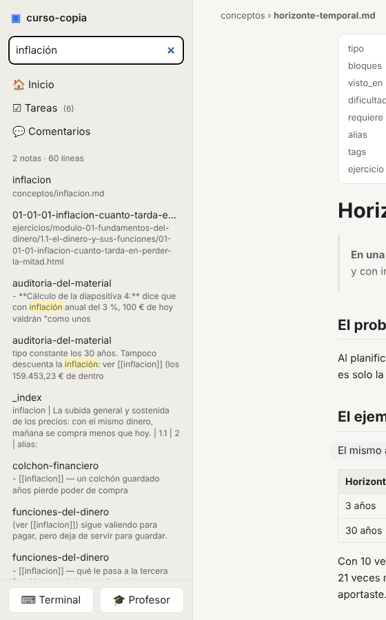
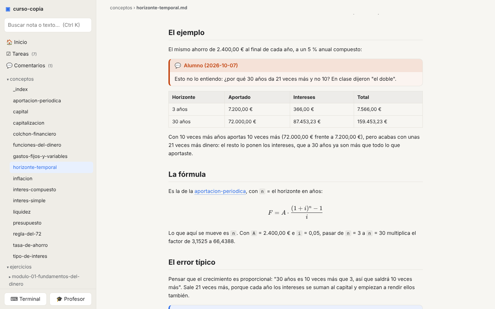
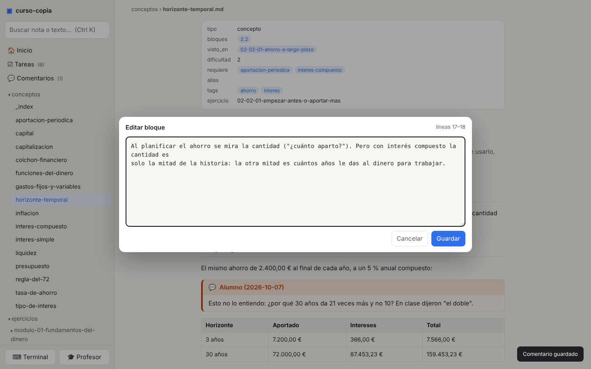
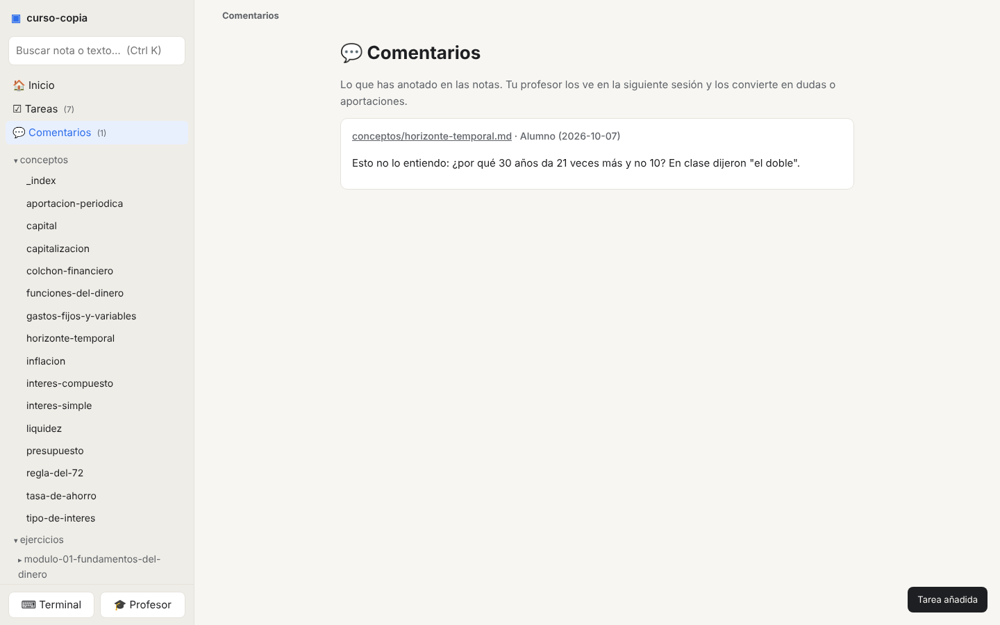
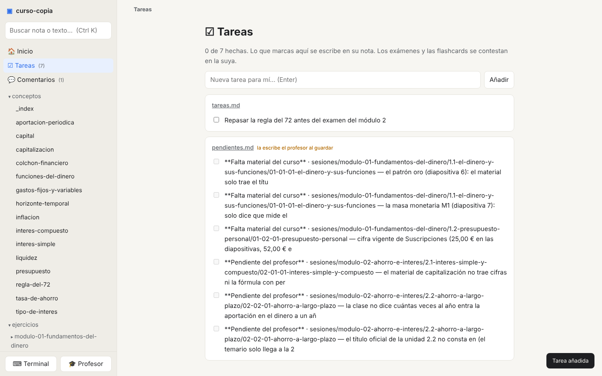

# cuaderno-app · punto 0

**Fecha:** 2026-10-07 · **Repo:** `rsotor/cuaderno-app` (privado al nacer, público después) · **Licencia:** MIT

## 1. Qué es

Una app local, en el navegador, para trabajar con un **cuaderno**: una carpeta de notas Markdown que genera y
mantiene un profesor-agente (Claude Code, Codex…) a partir de un curso. Hoy esa carpeta se abre con Obsidian.
La app lo sustituye con algo nuestro al 100 %: leer y editar las notas, contestar exámenes, apuntar tareas y
comentarios, hablar con el profesor y guardar al repo, todo en una ventana.

Puede haber tantos cuadernos como se quiera, cada uno en su carpeta y con su repo.

## 2. Para quién y por qué

Para el alumno de un curso montado con uno de nuestros kits. Obsidian nos daba un lector de Markdown ágil y
nada más: no sabe qué es un examen, qué es una tarea ni quién es el profesor, y hay cosas que el alumno hace
en el chat (marcar opciones) que no llegan a ningún sitio. Una app propia conoce la estructura del cuaderno y la
pinta como lo que es.

## 3. Principios

1. **La app es la ventana; el cuaderno es la verdad.** Todo lo que la app escribe es Markdown en los ficheros
   del cuaderno, en el formato que ya tienen. Sin base de datos, sin formatos propios.
2. **La lógica del curso no es de la app.** Corregir, calcular progreso, decidir si se puede guardar: lo hacen
   las herramientas del kit. La app las lanza y enseña su salida.
3. **Un kit funciona sin la app.** La app depende del kit; nunca al revés.
4. **Control total de la experiencia.** Render, tema, atajos, paneles: nuestros y configurables.
5. **Nada que esconder.** Repo público desde el diseño: sin secretos, sin tokens, sin rutas de nadie.

## 4. Casos de uso

| # | El alumno… | La app… |
|---|---|---|
| 1 | Abre el cuaderno | Enseña la **portada** (`inicio`): por dónde sigue, qué repasar, qué examen toca. Si hay cambios sin guardar o sin subir, se ve en la barra |
| 2 | Busca algo | **Buscador** por nombre de nota y por texto, sin acentos, con la línea donde aparece |
| 3 | Lee una nota | **Lector**: propiedades arriba, enlaces entre notas que funcionan (también en tablas), avisos y bloques plegables, tablas, fórmulas, "quién enlaza aquí" |
| 4 | Quiere cambiar algo pequeño | **Editar por bloques**: pasa el ratón por un párrafo, lista o tabla, lo edita en su Markdown, guarda ese tramo |
| 5 | No entiende algo, o en clase dijeron otra cosa | **Comentar un bloque**: queda anotado en la nota; el profesor lo recoge en la siguiente sesión. Un panel reúne todos los comentarios |
| 6 | Estudia una sesión | Lee, salta a sus conceptos, abre el **ejercicio interactivo** dentro de la app, marca la sesión como **estudiada** |
| 7 | Repasa flashcards | **Modo tarjeta**: pregunta, destapar, "la sabía / no la sabía" |
| 8 | Hace un examen | **Formulario completo** con botón **Validar**: la app escribe las respuestas y corrige con la herramienta del kit, sin pasar por el chat. Los de respuesta libre se **entregan** y los corrige el profesor |
| 9 | Se organiza | **Tareas**: todas las casillas del curso agrupadas por nota, más su lista propia. Marcar aquí escribe en la nota |
| 10 | Habla con el profesor | **Terminal integrada**, bonita, abierta en el cuaderno, con botón "Profesor". Más adelante, **chat** |
| 11 | Deja una clase nueva | Ve el **inbox** y lo que aún no está preparado; "Preparar con el profesor" |
| 12 | Termina | Botón **Guardar**: commit y push al repo del cuaderno con un mensaje propuesto. **Traer** si cambió en otro sitio. **Deshacer** lo último |
| 13 | Tiene varios cursos | **Pantalla de cuadernos**: recientes, abrir carpeta, cada uno con su nombre y su último guardado |

## 5. Lo que ya está hecho

Prototipo validado el 2026-10-07 sobre un curso real (52 ficheros), probado con Chromium: casos 1, 2, 3, 4, 5,
9 y 10 (terminal), más recarga en vivo y modo oscuro. Seis ficheros en Node sin build, en `prototipo/`:
`server.js`, `markdown.js`, `public/{index.html, estilo.css, app.js}`, `package.json`.
Dependencias: markdown-it, katex, xterm, node-pty, ws. Arranque: `npm install` · `node server.js <carpeta-del-cuaderno>`.

Capturas del prototipo (en `docs/capturas-prototipo/`), tal como salió, antes del repaso de diseño:

| Caso | Captura |
|---|---|
| 1 · Portada |  |
| 2 · Buscador |  |
| 3 · Lector: concepto con propiedades y tabla |  |
| 3 · Lector: fórmula y aviso plegable |  |
| 4 · Editar un bloque |  |
| 5 · Comentario en la nota |  |
| 5 · Panel de comentarios |  |
| 7 · Flashcards (aún sin modo tarjeta) |  |
| 8 · Examen con casilla marcada (aún sin formulario) |  |
| 9 · Tareas |  |
| 10 · Terminal |  |
| Modo oscuro |  |

## 6. Decisiones tomadas

| Tema | Decisión |
|---|---|
| Plataforma | Navegador + proceso local en Node. Sin app de escritorio empaquetada |
| Editor | Por bloques, en Markdown. Sin WYSIWYG ni vista previa partida |
| Anotar | Comentarios anclados a un bloque, dentro de la nota |
| Exámenes | Formulario HTML completo con Validar. El chat no genera nada |
| Agente | **Terminal en v1.** El chat con el profesor después, como modo opcional: hoy el SDK de Claude exige API key de pago y no admite la suscripción; Codex, por comprobar |
| Guardar | Un botón. En un cuaderno con kit, llama a la herramienta de guardar del kit (comprueba, apunta en el diario, sube); nunca git a mano. En una carpeta sin kit, git normal. Credenciales: las de git de la máquina |
| Varios cuadernos | Pantalla de inicio con recientes. La lista vive en la configuración del usuario, fuera de los repos |
| Configuración | Un `cuaderno.json` por cuaderno (tema, fuente, paneles, atajos, comando del agente) |
| Diseño | **Repaso de UX/UI con plugins antes de añadir funcionalidad.** Plugins del catálogo de Anthropic a activar en la sesión: **Design** (Anthropic; skills `design-critique`, `accessibility-review`, `ux-copy`) para la crítica pantalla a pantalla y los textos; **ux-ui-audit** (comunidad) para medir en el navegador contraste WCAG, tamaño de objetivos y foco; **frontend-design** (Anthropic) para aplicar los cambios con criterio. Entrada: las capturas de §5 y la app arrancada. Salida: lista priorizada, cambios aplicados, capturas de antes y después |

## 7. Fases

1. **Sembrar el repo:** prototipo, licencia, README, este documento como plan vivo, reglas del repo.
2. **Repaso de diseño** con los plugins de §6 (Design, ux-ui-audit, frontend-design), cambios aplicados, capturas antes y después. Puntos que ya se ven en las capturas: "editar / comentar" solo aparecen al pasar el ratón; el panel Tareas es denso; la cabecera de propiedades pesa más que el título; falta foco de teclado visible.
3. **Tests** del render y de las escrituras.
4. **Pantalla de cuadernos** y configuración.
5. **Guardar / Traer / Deshacer.**
6. **Formulario de examen** y **modo tarjeta** de flashcards.
7. **Terminal cuidada** (pestañas, fuente, tema) y botón Profesor.
8. **Inbox** y preparación de clases nuevas.
9. **`npx cuaderno <carpeta>`**, prueba en Mac y Windows, prueba real automatizada.
10. **Chat con el profesor** (cuando la autenticación lo permita).

Cada fase termina usable y guardada.

## 8. Fuera

Electron o Tauri · editor WYSIWYG · sincronización, cuentas o nube (el repo ya es la sync) · grafo de notas ·
móvil como objetivo · instalar o pagar el agente · cualquier lógica del curso dentro de la app.

## 9. Cómo sabremos

- Un recorrido por todas las notas de un curso real no encuentra enlaces rotos ni bloques sin pintar.
- Marcar, editar, comentar y añadir tarea desde la app dan el mismo fichero que hacerlo a mano.
- Un examen contestado en el formulario da la misma nota que marcado a mano y corregido con el kit.
- Guardar desde la app deja el repo igual que guardar desde la terminal.
- Una sesión entera con el profesor sin salir de la app.
- Crítica de diseño cerrada con cambios aplicados. Tests y prueba real en verde. Arranca en Mac y Windows.

## 10. Pendiente de decidir

Nombre del paquete npm · `node-pty` en Mac y Windows · si los comentarios viven en la nota o en un fichero
aparte (hoy, en la nota) · cómo adaptan los kits sus reglas de escritura "para Obsidian" cuando usen la app.

---
*Los detalles del kit (formatos, herramientas, reglas) viven en el repo del kit. Este documento es solo la app.*
